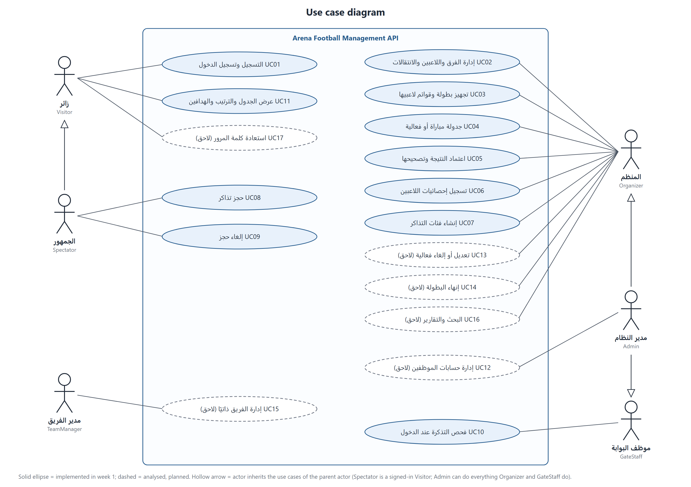

# تحليل نظام إدارة بطولات وفعاليات كرة القدم

<!-- table: kv -->
| بيانات المستند | |
|---|---|
| المشروع | Arena Football Management: نظام إدارة الفرق واللاعبين والبطولات والمباريات والنتائج والترتيب والإحصائيات وحجز التذاكر |
| نوع التسليم | تحليل النظام، تسليم الأسبوع الأول |
| التقنيات | C# و ASP.NET Core Web API على .NET 10، و EF Core 10 (Code First)، و SQL Server |
| الفريق | 4 أفراد، ويتولى قائد الفريق التكامل والمراجعة |
| الإصدار | 1.1 بتاريخ 16 نوفمبر 2026 |
| مستندات مرتبطة | تصميم قاعدة البيانات والتحويل (EERD و Mapping)، وملف README، وتقرير التحقق |

<!-- pagebreak -->

## سجل الإصدارات

<!-- widths: 12,20,68 -->
| الإصدار | التاريخ | التغييرات |
|---|---|---|
| 1.0 | 15 نوفمبر 2026 | النسخة الأولى: النطاق والمستخدمون و30 متطلبًا وظيفيًا وحالات الاستخدام الأساسية وقواعد العمل والمعمارية. |
| 1.1 | 16 نوفمبر 2026 | إضافة مخطط حالات الاستخدام، وجدول لكل حالة استخدام (17 حالة تشمل الحالات المخططة)، وربط كل متطلب بحالة استخدام. تحديث المعمارية بعد تقسيم الكود إلى خدمة لكل Feature. توثيق التحقق على SQL Server وإصلاح الحجز المتزامن. |

[[TOC]]

## الغرض والنطاق

### الغرض من المستند

نطوّر نظامًا مركزيًا لإدارة فرق كرة القدم واللاعبين والبطولات والمباريات والنتائج وترتيب الدوري والإحصائيات، مع حجز تذاكر للجمهور والتحقق منها عند الدخول. هذا المستند هو مرجع المتطلبات وقواعد العمل ومعايير القبول، ويُحدَّث مع تقدم التنفيذ، ويتابع منه المحاضر تطور المشروع في كل مناقشة.

### المشكلة والقيمة المتوقعة

الاعتماد على ملفات منفصلة للفرق واللاعبين والنتائج والتذاكر يؤدي إلى تكرار البيانات وتأخر الترتيب وصعوبة تتبع التعديلات. يجمع النظام هذه العمليات حول بطولة موحدة، ويحفظ تاريخ عضويات اللاعبين، ويشتق الترتيب من النتائج المعتمدة، ويمنع بيع تذاكر أكثر من المتاح حتى مع الطلبات المتزامنة.

### قرار النطاق

الإصدار الأول لكرة القدم فقط، بنظام دوري: 3 نقاط للفوز ونقطة للتعادل ولا نقاط للخسارة. تشمل الفعاليات المباريات وأيام الجمهور والأنشطة المرتبطة بكرة القدم. واجهة التسليم Web API؛ تصميم واجهة مستخدم نهائية ليس ضمن مهام هذا الأسبوع.

<!-- widths: 18,42,40 -->
| المجال | داخل الإصدار الأول | حدود التنفيذ |
|---|---|---|
| الحسابات | تسجيل الجمهور والدخول والصلاحيات | إدارة الموظفين واستعادة كلمة المرور مخططة |
| الفرق واللاعبون | بيانات الفرق واللاعبين والانتقالات والقوائم | صلاحيات مدير الفريق الذاتية مخططة |
| البطولات والمباريات | دوري وتسجيل فرق وجدولة يدوية ونتائج | التوليد الآلي للمباريات وخروج المغلوب خارج النطاق |
| الإحصائيات | الترتيب والهدافون والأهداف والتمريرات والبطاقات | لا تحليل فيديو ولا توقعات |
| التذاكر | فئات بسعة وسعر، وحجز وإلغاء وفحص عند الدخول | دخول عام دون مقاعد مرقمة، ولا بوابة دفع |
| الفعاليات | فعاليات جماهيرية لكرة القدم | لا قواعد نتائج لرياضات أخرى |

### حالة المتطلبات

- **منفذ:** توجد له شيفرة ومسارات API قابلة للتشغيل في هذا التسليم.
- **مخطط:** تم تحليله وله حالة استخدام ومعيار قبول، لكنه غير جاهز للاستخدام الآن.
- **خارج النطاق:** يحتاج قرار توسع منفصل من الفريق والمحاضر.

### معيار نجاح التسليم

يستطيع أي عضو في الفريق فتح الحل، وتشغيل نسخة العرض، وتنفيذ حجز وإلغائه، وعرض ترتيب الدوري، وشرح العلاقات والقيود، وتحديد الملفات المسؤولة عن كل طبقة. ويستطيع الفريق مراجعة أي Feature برقم المتطلب وحالة الاستخدام ومعيار القبول.

## المستخدمون والصلاحيات

<!-- widths: 18,32,50 -->
| المستخدم | المسؤولية | الصلاحية الحالية |
|---|---|---|
| زائر (Visitor) | متابعة الجدول والنتائج والترتيب | قراءة الفرق والبطولات والفعاليات وعروض التذاكر والإحصائيات العامة |
| الجمهور (Spectator) | حجز التذاكر ومتابعة حجوزاته | كل ما يفعله الزائر، وإنشاء حجز وعرض حجوزاته وإلغاؤها قبل المهلة |
| المنظم (Organizer) | إدارة التشغيل الرياضي | الفرق واللاعبون والبطولات والمباريات والنتائج وفئات التذاكر |
| موظف البوابة (GateStaff) | التحقق من الدخول | فحص تذكرة لفعالية محددة ومنع تكرار الدخول |
| مدير النظام (Admin) | الإدارة العامة | كل صلاحيات المنظم وموظف البوابة، وقراءة أي حجز، وإدارة الموظفين (مخطط) |
| مدير الفريق (TeamManager) | إدارة فريقه | الدور موجود في النموذج؛ عملياته الذاتية مخططة (UC15) |

### حدود الثقة

يُنشأ كل تسجيل عام بدور Spectator مهما احتوى الطلب من حقول إضافية. يُنشأ أول Admin بأمر تهيئة محلي وبيانات سرية من متغيرات البيئة. الموظفون منظمون موثوقون على مستوى النظام كله؛ هذا الإصدار ليس نظامًا متعدد المؤسسات.

صلاحية قراءة الحجز وإلغائه لمالكه أو لمدير النظام فقط، والوصول لحجز مستخدم آخر يعيد 404 حتى لا يُكشف وجوده. بيانات اللاعب الخاصة مثل تاريخ الميلاد متاحة لمسارات الإدارة فقط، بينما تعرض قائمة الهدافين الاسم والمجاميع الرياضية.

### سياسة المصادقة

رمز JWT صالح 60 دقيقة افتراضيًا، مع التحقق من المُصدر والجمهور والتوقيع والانتهاء. في كل طلب مصادَق يعاد فحص أن الحساب نشط وأن دوره لم يتغير، فيسري تعطيل الحساب أو تغيير الدور فورًا. كلمات المرور تُخزن كقيمة Hash باستخدام PasswordHasher في ASP.NET Core. لا توجد Refresh Tokens ولا استعادة بالبريد في هذا الإصدار.

### مخطط حالات الاستخدام



السهم المفرغ يعني أن الفاعل يرث حالات استخدام الفاعل الأب: الجمهور زائر سجّل دخوله، ومدير النظام يستطيع كل ما يفعله المنظم وموظف البوابة.

## المتطلبات الوظيفية

كل وصف أدناه حد أدنى للقبول. تفاصيل الشروط والاستثناءات في حالات الاستخدام وقواعد العمل، ويُراجع التنفيذ بقائمة الاختبارات.

<!-- widths: 9,63,14,14 -->
| المعرف | المتطلب ومعيار القبول | حالة الاستخدام | الحالة |
|---|---|---|---|
| FR01 | تسجيل حساب جمهور ببريد فريد وكلمة مرور من 12 إلى 128 حرفًا؛ لا يمكن طلب دور إداري. | UC01 | منفذ |
| FR02 | تسجيل الدخول وإرجاع JWT؛ رفض بيانات الدخول الخاطئة والحساب غير النشط. | UC01 | منفذ |
| FR03 | إدارة أدوار موظفي النظام وحالتهم بواسطة Admin؛ منع تعطيل آخر Admin نشط. | UC12 | مخطط |
| FR04 | إنشاء فريق وقراءته وتعديل بياناته وأرشفته؛ كود الفريق فريد ولا يتغير. | UC02 | منفذ |
| FR05 | إنشاء لاعب وقراءة بياناته للإدارة؛ تاريخ ميلاد سابق لليوم ومركز من القيم المعتمدة. | UC02 | منفذ |
| FR06 | تسجيل العضوية والانتقال بين الفرق مع حفظ الفترات السابقة وعضوية مفتوحة واحدة. | UC02 | منفذ |
| FR07 | إنشاء بطولة وقراءتها؛ الاسم والموسم معًا فريدان وفترة التاريخ صحيحة. | UC03 | منفذ |
| FR08 | تسجيل فريق نشط مرة واحدة في البطولة أثناء فتح التسجيل. | UC03 | منفذ |
| FR09 | تثبيت قائمة البطولة؛ اللاعب في فريق واحد لكل بطولة ورقم القميص لا يتكرر داخل الفريق. | UC03 | منفذ |
| FR10 | بدء البطولة بعد تسجيل فريقين على الأقل وجدولة مباراة واحدة؛ يُغلق التسجيل والقوائم. | UC03 | منفذ |
| FR11 | جدولة مباراة يدويًا بين فريقين مسجلين ومختلفين ضمن فترة البطولة. | UC04 | منفذ |
| FR12 | منع تداخل وقت المباراة مع أي فعالية في نفس الملعب أو أي مباراة لأحد الفريقين. | UC04 | منفذ |
| FR13 | اعتماد النتيجة بعد نهاية المباراة وتصحيحها بسبب موثق؛ حفظ القيم السابقة والفاعل. | UC05 | منفذ |
| FR14 | حساب الترتيب من المباريات المنتهية فقط دون تخزين مجموع نقاط قابل للانحراف. | UC05، UC11 | منفذ |
| FR15 | تسجيل إحصائية لكل لاعب في المباراة من قائمة بطولته؛ أهداف اللاعبين لا تتجاوز نتيجة فريقهم. | UC06 | منفذ |
| FR16 | عرض أفضل 50 لاعبًا حسب الأهداف ثم التمريرات الحاسمة ثم المعرف. | UC11 | منفذ |
| FR17 | إنشاء ملعب وقراءة بياناته وسعته؛ السعة أكبر من صفر. | UC04 | منفذ |
| FR18 | إنشاء فعالية جماهيرية بوصف وملعب وفترة؛ تشترك مع المباريات في نظام التذاكر. | UC04 | منفذ |
| FR19 | إنشاء فئة تذاكر بسعر وسعة ونافذة بيع؛ مجموع سعات الفئات لا يتجاوز سعة الملعب. | UC07 | منفذ |
| FR20 | حجز من 1 إلى 10 تذاكر في الطلب الواحد بسعر محفوظ وقت الحجز، مع كود لكل تذكرة. | UC08 | منفذ |
| FR21 | إعادة طلب الحجز بنفس المفتاح والبيانات تعيد نفس الحجز؛ تغيير البيانات مع نفس المفتاح مرفوض. | UC08 | منفذ |
| FR22 | عرض حجوزات المستخدم وتفاصيلها وأكوادها فقط؛ Admin يستطيع قراءة أي حجز. | UC08 | منفذ |
| FR23 | إلغاء الحجز قبل ساعتين من البداية وإعادة المخزون مرة واحدة؛ لا إلغاء بعد استخدام تذكرة. | UC09 | منفذ |
| FR24 | فحص التذكرة لفعالية محددة ضمن نافذة الدخول، ورفض الملغاة والمستخدمة. | UC10 | منفذ |
| FR25 | تعديل موعد أو ملعب فعالية مستقبلية أو إلغاؤها، مع معالجة الحجوزات في معاملة واحدة. | UC13 | مخطط |
| FR26 | إنهاء البطولة بعد انتهاء أو إلغاء كل مبارياتها، وقفل تعديل النتائج بعدها. | UC14 | مخطط |
| FR27 | تمكين مدير الفريق من تعديل فريقه ولاعبيه فقط، مع فحص ملكية الفريق في الخدمة. | UC15 | مخطط |
| FR28 | تقسيم القوائم إلى صفحات بترتيب ثابت وحد أقصى 100 سجل للصفحة. | UC11 | منفذ |
| FR29 | البحث والتصفية حسب البطولة والفريق والتاريخ والحالة، وتصدير التقارير. | UC16 | مخطط |
| FR30 | استعادة كلمة المرور برمز محدود المدة، وإبطال الجلسات السابقة بعد التغيير. | UC17 | مخطط |

**الإجمالي:** 24 متطلبًا منفذًا و6 متطلبات مخططة.

## حالات الاستخدام

كل حالة استخدام موصوفة بنفس القالب: الفاعل، والمتطلبات المرتبطة، والشروط المسبقة، والمسار الأساسي، والمسارات البديلة، والنتيجة. الحالات المخططة لها تصميم مقترح يُراجع قبل تنفيذها.

### الحسابات

<!-- table: kv -->
| UC01 | التسجيل وتسجيل الدخول |
|---|---|
| الفاعل | زائر |
| المتطلبات | FR01، FR02 |
| الشروط المسبقة | لا يوجد. |
| المسار الأساسي | 1. يرسل الزائر الاسم والبريد وكلمة المرور.<br>2. يتحقق النظام من الحقول ويوحّد البريد للمقارنة ويتأكد من عدم تكراره.<br>3. يحفظ Hash كلمة المرور بدور Spectator.<br>4. يصدر رمز دخول JWT يستخدمه العميل في ترويسة Authorization. |
| المسارات البديلة | الحقول غير الصالحة تعيد 400، والبريد المكرر 409، وبيانات الدخول الخاطئة أو الحساب المعطل 401. أكثر من 10 محاولات في الدقيقة من نفس العنوان تعيد 429. |
| النتيجة | حساب جديد دون صلاحيات إدارية، أو رمز دخول لحساب موجود. |
| الحالة | منفذ |

<!-- table: kv -->
| UC17 | استعادة كلمة المرور |
|---|---|
| الفاعل | زائر |
| المتطلبات | FR30 |
| الشروط المسبقة | حساب نشط وخدمة بريد مهيأة. |
| المسار الأساسي | 1. يطلب الزائر الاستعادة ببريده.<br>2. يرسل النظام رمزًا عشوائيًا صالحًا 15 دقيقة، ويخزن Hash الرمز فقط.<br>3. يرسل الزائر الرمز وكلمة المرور الجديدة.<br>4. يغير النظام كلمة المرور ويبطل الرموز السابقة بتغيير ختم الأمان. |
| المسارات البديلة | البريد غير المسجل يعطي نفس الاستجابة حتى لا يُكشف وجود الحساب. الرمز المنتهي أو المستخدم يعيد 400. |
| النتيجة | كلمة مرور جديدة والجلسات القديمة غير صالحة. |
| الحالة | مخطط |

### الفرق واللاعبون والبطولات

<!-- table: kv -->
| UC02 | إدارة الفرق واللاعبين والانتقالات |
|---|---|
| الفاعل | المنظم أو مدير النظام |
| المتطلبات | FR04، FR05، FR06 |
| الشروط المسبقة | مستخدم مسجل الدخول بدور إداري. |
| المسار الأساسي | 1. ينشئ المنظم الفريق بكود فريد.<br>2. ينشئ اللاعب بتاريخ ميلاد ومركز من القيم المعتمدة.<br>3. يسجل عضوية اللاعب في الفريق بتاريخ انضمام.<br>4. عند الانتقال يغلق النظام العضوية المفتوحة في تاريخ الانتقال ويفتح عضوية جديدة في معاملة واحدة. |
| المسارات البديلة | كود فريق مكرر يعيد 409. الانتقال إلى نفس الفريق، أو بتاريخ لا يلي بداية العضوية الحالية، أو بتاريخ مستقبلي يعيد 409. تعديل الفريق بنسخة قديمة (Version) يعيد 409. |
| النتيجة | فريق ولاعب وتاريخ عضويات كامل لا يتغير بأثر رجعي. |
| الحالة | منفذ |

> حذف الفريق من API هو أرشفة فقط: لا يُحذف فريق مشارك ولا النتائج والحجوزات التابعة له. الأرشفة تمنع التسجيلات الجديدة وتُبقي السجلات التاريخية.

<!-- table: kv -->
| UC03 | تجهيز بطولة وقوائم لاعبيها |
|---|---|
| الفاعل | المنظم أو مدير النظام |
| المتطلبات | FR07، FR08، FR09، FR10 |
| الشروط المسبقة | فرق نشطة ولاعبون لهم عضويات مفتوحة. |
| المسار الأساسي | 1. ينشئ المنظم بطولة باسم وموسم وتاريخي بداية ونهاية؛ تبدأ في حالة فتح التسجيل.<br>2. يسجل فريقين نشطين أو أكثر.<br>3. يضيف لاعبي كل فريق إلى القائمة بأرقام قمصانهم؛ يجب أن تكون للاعب عضوية مفتوحة في الفريق.<br>4. بعد جدولة مباراة واحدة على الأقل يبدأ البطولة، فيُغلق التسجيل والقوائم. |
| المسارات البديلة | فريق مسجل مسبقًا، أو لاعب في فريق آخر بنفس البطولة، أو رقم قميص مكرر، أو تعديل القائمة بعد البدء: كلها تُرفض بـ 409 دون إنشاء سجل جزئي. |
| النتيجة | بطولة جاهزة بقوائم ثابتة لا تتأثر بانتقالات اللاعبين اللاحقة. |
| الحالة | منفذ |

<!-- table: kv -->
| UC15 | إدارة الفريق ذاتيًا |
|---|---|
| الفاعل | مدير الفريق |
| المتطلبات | FR27 |
| الشروط المسبقة | حساب بدور TeamManager معيّن كمدير للفريق (Teams.ManagerId). |
| المسار الأساسي | 1. يعرض مدير الفريق بيانات فريقه.<br>2. يعدّل الاسم أو المدينة، أو يضيف لاعبين وعضويات لفريقه.<br>3. تتحقق الخدمة أن الفريق المستهدف يخص المستخدم قبل أي تعديل. |
| المسارات البديلة | محاولة تعديل فريق آخر تعيد 404. تعديل بنسخة قديمة يعيد 409. |
| النتيجة | يحدّث كل فريق بياناته دون تدخل المنظم. |
| الحالة | مخطط |

### المباريات والنتائج

<!-- table: kv -->
| UC04 | جدولة مباراة أو فعالية جماهيرية |
|---|---|
| الفاعل | المنظم أو مدير النظام |
| المتطلبات | FR11، FR12، FR17، FR18 |
| الشروط المسبقة | ملعب مسجل بسعته. للمباراة: بطولة غير مكتملة وفريقان مسجلان فيها. |
| المسار الأساسي | 1. يرسل المنظم الملعب وبداية ونهاية الفعالية بتوقيت UTC، ومعها للمباراة: البطولة والفريقان والجولة والدور.<br>2. يتحقق النظام من اختلاف الفريقين وتسجيلهما ووقوع المباراة داخل فترة البطولة.<br>3. داخل معاملة Serializable يفحص التعارض مع فعاليات الملعب ومباريات الفريقين.<br>4. يحفظ الفعالية. |
| المسارات البديلة | التعارض يعيد 409 بالرمز schedule_conflict. التوقيت غير المنتهي بحرف Z أو نهاية قبل البداية يعيد 409. |
| النتيجة | فعالية مجدولة يمكن بيع تذاكرها. |
| الحالة | منفذ |

> قاعدة التعارض: تتعارض فعاليتان إذا بدأت كل منهما قبل نهاية الأخرى. يُسمح بانتهاء فعالية في نفس لحظة بدء أخرى. وقت تجهيز الملعب لا يُضاف تلقائيًا؛ يُدخله المنظم ضمن الفترة عند الحاجة.

<!-- table: kv -->
| UC05 | اعتماد النتيجة وتصحيحها |
|---|---|
| الفاعل | المنظم أو مدير النظام |
| المتطلبات | FR13، FR14 |
| الشروط المسبقة | بطولة جارية، ومباراة غير ملغاة انتهى وقتها. |
| المسار الأساسي | 1. يرسل المنظم نتيجتي الفريقين وسبب الاعتماد أو التصحيح ونسخة المباراة (Version).<br>2. يتحقق النظام من النسخة ومن أن أهداف اللاعبين المسجلة لا تتجاوز النتيجة الجديدة.<br>3. في معاملة واحدة يحفظ النتيجة وحالة Finished وسجل ResultAudit بالقيم السابقة والجديدة والفاعل والوقت. |
| المسارات البديلة | نسخة قديمة تعيد 409. خفض النتيجة عن أهداف اللاعبين المسجلة مرفوض حتى تُصحح إحصائياتهم أولًا. |
| النتيجة | نتيجة معتمدة وسجل تدقيق؛ الترتيب يُشتق من جديد دون جمع نقاط فوق نقاط. |
| الحالة | منفذ |

<!-- table: kv -->
| UC06 | تسجيل إحصائيات اللاعبين |
|---|---|
| الفاعل | المنظم أو مدير النظام |
| المتطلبات | FR15 |
| الشروط المسبقة | نتيجة معتمدة، واللاعب في قائمة فريقه بنفس البطولة، والفريق طرف في المباراة. |
| المسار الأساسي | 1. يرسل المنظم الأهداف والتمريرات الحاسمة والبطاقات والدقائق للاعب.<br>2. يتحقق النظام من القائمة ومن أن مجموع الأهداف المنسوبة لا يتجاوز نتيجة الفريق.<br>3. يحفظ سجلًا واحدًا لكل لاعب في كل مباراة؛ التحديث يستبدل القيم السابقة. |
| المسارات البديلة | لاعب خارج القائمة أو أهداف تتجاوز النتيجة: 409. الدقائق من 0 إلى 130، والبطاقات الصفراء حتى 2 والحمراء حتى 1. |
| النتيجة | إحصائيات تغذي قائمة الهدافين. يمكن أن تقل الأهداف المنسوبة عن النتيجة بسبب هدف عكسي. |
| الحالة | منفذ |

<!-- table: kv -->
| UC11 | عرض الجدول والترتيب والهدافين |
|---|---|
| الفاعل | زائر (وكل المستخدمين) |
| المتطلبات | FR14، FR16، FR28 |
| الشروط المسبقة | لا يوجد. |
| المسار الأساسي | 1. يطلب الزائر قائمة البطولات أو الفعاليات أو الفرق مقسمة صفحات.<br>2. يطلب ترتيب بطولة: يحسبه النظام من المباريات المنتهية فقط بنظام 3 و1 و0.<br>3. يطلب الهدافين: أفضل 50 لاعبًا حسب الأهداف ثم التمريرات. |
| المسارات البديلة | بطولة غير موجودة 404. حجم صفحة أكبر من 100 يعيد 400. |
| النتيجة | بيانات عامة متسقة مع آخر نتائج معتمدة. |
| الحالة | منفذ |

> كسر التعادل في الترتيب: النقاط، ثم فارق الأهداف، ثم الأهداف المسجلة، ثم معرف الفريق لثبات العرض فقط. المعرف ليس قاعدة رياضية؛ يعتمد الفريق قاعدة رسمية إضافية قبل إعلان بطل عند استمرار التعادل.

<!-- table: kv -->
| UC14 | إنهاء البطولة |
|---|---|
| الفاعل | المنظم أو مدير النظام |
| المتطلبات | FR26 |
| الشروط المسبقة | بطولة جارية، وكل مبارياتها منتهية أو ملغاة. |
| المسار الأساسي | 1. يطلب المنظم إنهاء البطولة بنسختها الحالية.<br>2. يتحقق النظام من عدم وجود مباريات مجدولة.<br>3. ينقل البطولة إلى Completed ويقفل اعتماد النتائج وتصحيحها. |
| المسارات البديلة | وجود مباريات معلقة يعيد 409 مع عددها. نسخة قديمة 409. |
| النتيجة | ترتيب نهائي ثابت. |
| الحالة | مخطط |

<!-- table: kv -->
| UC13 | تعديل أو إلغاء فعالية |
|---|---|
| الفاعل | المنظم أو مدير النظام |
| المتطلبات | FR25 |
| الشروط المسبقة | فعالية مجدولة لم تبدأ. |
| المسار الأساسي | 1. التعديل: يرسل المنظم موعدًا أو ملعبًا جديدًا؛ يعيد النظام فحص التعارض، ويتأكد أن سعة الملعب الجديد تكفي سعات فئات التذاكر.<br>2. الإلغاء: في معاملة واحدة تصبح الفعالية Cancelled وتُلغى حجوزاتها المؤكدة ويُعاد مخزونها. |
| المسارات البديلة | فعالية بدأت أو انتهت: 409. ملعب أصغر من التذاكر المخصصة: 409. |
| النتيجة | جدول محدث دون حجوزات معلقة على فعالية ملغاة. إشعار الجمهور خارج هذا الإصدار. |
| الحالة | مخطط |

<!-- table: kv -->
| UC16 | البحث والتقارير |
|---|---|
| الفاعل | المنظم (والزائر للبحث العام) |
| المتطلبات | FR29 |
| الشروط المسبقة | لا يوجد. |
| المسار الأساسي | 1. يصفّي المستخدم المباريات والفعاليات حسب البطولة والفريق والفترة والحالة.<br>2. يصدّر المنظم الترتيب أو الهدافين أو مبيعات التذاكر كملف CSV. |
| المسارات البديلة | معايير غير صالحة 400. |
| النتيجة | تقارير بنفس قواعد الحساب المستخدمة في العرض. |
| الحالة | مخطط |

### التذاكر

<!-- table: kv -->
| UC07 | إنشاء فئات التذاكر |
|---|---|
| الفاعل | المنظم أو مدير النظام |
| المتطلبات | FR19 |
| الشروط المسبقة | فعالية مجدولة في المستقبل. |
| المسار الأساسي | 1. يرسل المنظم اسم الفئة وسعرها بالجنيه المصري وسعتها ونافذة البيع.<br>2. داخل معاملة Serializable يتحقق النظام أن مجموع سعات الفئات لا يتجاوز سعة الملعب وأن نافذة البيع تنتهي قبل بداية الفعالية.<br>3. يحفظ الفئة. |
| المسارات البديلة | تجاوز السعة أو نافذة غير صالحة أو سعر بأكثر من منزلتين عشريتين: 409. |
| النتيجة | مخزون قابل للحجز. |
| الحالة | منفذ |

<!-- table: kv -->
| UC08 | حجز تذاكر |
|---|---|
| الفاعل | الجمهور |
| المتطلبات | FR20، FR21، FR22 |
| الشروط المسبقة | مستخدم مسجل الدخول، وفئة تذاكر ضمن نافذة البيع لفعالية لم تبدأ. |
| المسار الأساسي | 1. يختار المستخدم الفئة وكمية من 1 إلى 10 ويرسل مفتاح IdempotencyKey جديدًا لكل عملية شراء.<br>2. يتحقق النظام من نافذة البيع وحالة الفعالية.<br>3. يخصم الكمية بأمر UPDATE شرطي واحد ينجح فقط إذا كان المتبقي كافيًا.<br>4. يحفظ الحجز بسعر الوحدة وقت الحجز، وينشئ كودًا عشوائيًا مستقلًا لكل تذكرة.<br>5. تُحفظ كل الخطوات في معاملة واحدة؛ أي فشل يتراجع عنها كلها. |
| المسارات البديلة | الكمية غير متاحة: 409 sold_out. نفس المفتاح بنفس البيانات: يعود نفس الحجز دون خصم جديد. نفس المفتاح ببيانات مختلفة: 409 idempotency_conflict. طلبان بنفس المفتاح في نفس اللحظة: ينجح أحدهما ويعيد الآخر 409، وإعادة المحاولة تعيد الحجز الأول. |
| النتيجة | حجز Confirmed وتذاكر يراها المستخدم في حجوزاته. الحالة Confirmed تعني تثبيت الحجز لا تحصيل المال؛ الدفع عند البوابة خارج هذا الإصدار ولا تُخزن بيانات بطاقات. |
| الحالة | منفذ |

<!-- table: kv -->
| UC09 | إلغاء حجز |
|---|---|
| الفاعل | صاحب الحجز أو مدير النظام |
| المتطلبات | FR23 |
| الشروط المسبقة | الحجز مؤكد، والوقت قبل بداية الفعالية بساعتين على الأقل. |
| المسار الأساسي | 1. يطلب المستخدم الإلغاء.<br>2. يغيّر النظام حالة الحجز إلى Cancelled ويحفظها أولًا، فيُقفل صف الحجز.<br>3. يتحقق بعد القفل أنه لم تُستخدم أي تذكرة من الحجز.<br>4. يعيد الكمية إلى المخزون بأمر UPDATE واحد، ثم يُثبت المعاملة. |
| المسارات البديلة | إلغاء ثانٍ لحجز ملغى يعيد نفس الحجز دون إعادة مخزون. إلغاءان في نفس اللحظة: ينجح واحد ويعيد الآخر 409. تذكرة مستخدمة أو تجاوز المهلة: 409. |
| النتيجة | حجز ملغى ومخزون عاد مرة واحدة فقط. لا يُحذف الحجز ولا التذاكر. |
| الحالة | منفذ |

<!-- table: kv -->
| UC10 | فحص التذكرة عند الدخول |
|---|---|
| الفاعل | موظف البوابة أو مدير النظام |
| المتطلبات | FR24 |
| الشروط المسبقة | نافذة الدخول مفتوحة: من ساعتين قبل البداية حتى نهاية الفعالية. |
| المسار الأساسي | 1. يرسل الموظف كود التذكرة ومعرف الفعالية.<br>2. يتحقق النظام أن التذكرة تخص هذه الفعالية وأن الحجز مؤكد والفعالية غير ملغاة.<br>3. يسجل وقت الفحص وهوية الموظف. |
| المسارات البديلة | تذكرة لفعالية أخرى أو ملغاة أو مستخدمة أو خارج نافذة الدخول: 409. كود غير موجود: 404. |
| النتيجة | دخول واحد لكل تذكرة. |
| الحالة | منفذ |

<!-- table: kv -->
| UC12 | إدارة حسابات الموظفين |
|---|---|
| الفاعل | مدير النظام |
| المتطلبات | FR03 |
| الشروط المسبقة | Admin مسجل الدخول. |
| المسار الأساسي | 1. ينشئ المدير حساب موظف بدور Organizer أو GateStaff أو TeamManager.<br>2. يغيّر دور موظف أو يعطّل حسابه.<br>3. يسري التغيير في الطلب التالي، لأن الدور والحالة يُفحصان مع كل طلب. |
| المسارات البديلة | بريد مكرر 409. تعطيل آخر Admin نشط أو خفض دوره مرفوض بـ 409. |
| النتيجة | إدارة الموظفين دون تعديل مباشر في قاعدة البيانات. |
| الحالة | مخطط |

## قواعد العمل وسلامة البيانات

<!-- widths: 9,51,40 -->
| المعرف | قاعدة العمل | مكان الفرض |
|---|---|---|
| BR01 | البريد بعد التوحيد وكود الفريق فريدان | فهرس فريد وخدمة التطبيق |
| BR02 | عضوية مفتوحة واحدة لكل لاعب | فهرس فريد مشروط ومعاملة الانتقال |
| BR03 | الفريق يُسجل مرة واحدة في البطولة | مفتاح بديل مركب |
| BR04 | اللاعب في فريق واحد لكل بطولة | فهرس فريد مركب |
| BR05 | طرفا المباراة مسجلان في بطولتها | مفتاحان أجنبيان مركبان |
| BR06 | كل فعالية من نوع واحد فقط | عمود EventType وقيد CHECK |
| BR07 | النتيجة مكتملة وغير سالبة عند انتهاء المباراة | CHECK وخدمة الاعتماد |
| BR08 | لا تعارض في وقت الملعب أو الفريق | خدمة الجدولة ومعاملة Serializable |
| BR09 | مجموع سعات الفئات لا يتجاوز سعة الملعب | تجميع داخل معاملة Serializable |
| BR10 | المباع بين صفر وسعة الفئة | UPDATE شرطي واحد وقيد CHECK |
| BR11 | مفتاح الحجز فريد داخل حساب المستخدم | فهرس فريد على UserId و IdempotencyKey |
| BR12 | التذكرة لا تدخل مرتين ولا لحجز ملغى | فحص الخدمة و Version ومعاملة الدخول |
| BR13 | إحصائية اللاعب تخص نفس مباراة فريقه وبطولته | مفتاح أجنبي مركب للقائمة وفحوص الخدمة |
| BR14 | السجلات التاريخية لا تُحذف بالتتابع | Restrict لكل العلاقات |

### التزامن

كل جدول فيه عمود Version من نوع Guid يتغير مع كل حفظ، ويقارنه EF Core بالقيمة الأصلية، فيفشل أي تحديث مبني على قراءة قديمة بـ 409. العميل يعيد القراءة ثم يقرر إعادة المحاولة؛ في الحجز يعيد المحاولة بنفس المفتاح.

المخزون لا يُقرأ ثم يُعدّل؛ يتغير بأمر واحد:

```
UPDATE TicketOffers
SET    SoldQuantity = SoldQuantity + @n, Version = @newVersion
WHERE  Id = @id AND Capacity - SoldQuantity >= @n
```

قاعدة البيانات تفحص المتبقي وتعدله في نفس اللحظة وتحتفظ بقفل الصف حتى نهاية المعاملة، فتنتظر الطلبات المتزامنة دورها بدل أن تقع في deadlock. لذلك يعمل الحجز والإلغاء بمستوى ReadCommitted، بينما تبقى Serializable للقواعد التي تفحص صفوفًا لم تُنشأ بعد، مثل تعارض المواعيد ومجموع سعات الفئات.

> تم اختبار ذلك على SQL Server: 100 طلب حجز في نفس اللحظة على 30 تذكرة أنتجت 30 حجزًا بالضبط و70 ردًا 409 sold_out، دون أي خطأ 500. السكربت `scripts/test-concurrency.ps1` يعيد الاختبار على أي خادم.

## المتطلبات غير الوظيفية

<!-- widths: 15,45,40 -->
| المجال | معيار القبول | طريقة التحقق والحالة |
|---|---|---|
| الأمان | لا أسرار في المستودع ولا Hash في الاستجابات؛ HTTPS عند النشر؛ فصل صلاحيات الإدارة والجمهور | مراجعة الإعدادات واختبارات 401 و 403 وملكية الحجز: منفذ |
| صحة البيانات | لا مخزون سالب أو فوق السعة، ولا حجز جزئي عند الفشل، ولا بيع زائد مع التزامن | اختبارات علائقية واختبار تزامن على SQL Server: ناجح |
| الأداء المستهدف | زمن p95 أقل من 500ms للقراءات الأساسية مع 50 مستخدمًا متزامنًا | اختبار حمل لاحق على SQL Server: لم يُقس بعد |
| القابلية للصيانة | لا مرجع EF Core في Domain أو Application؛ منطق العمل خارج Controllers؛ ملف لكل نوع | فحص مراجع المشروعات ومراجعة Pull Request: منفذ |
| المراقبة | ProblemDetails مع traceId للأخطاء، ومسارا liveness و readiness | اختبار HTTP وسجلات الخادم: منفذ |
| الاسترجاع | نسخة احتياطية يومية وتجربة استعادة قبل النشر | إجراء تشغيلي لاحق مع مسؤول قاعدة البيانات |
| الوقت والعملة | UTC في العقد والقاعدة؛ العملة EGP بمنزلتين عشريتين | اختبارات JSON ومراجعة أعمدة decimal: منفذ |
| الاختبارات | نجاح البناء والاختبارات وعدم وجود فرق غير مُرحّل في نموذج EF | `scripts/verify.ps1` و CI: 23 اختبارًا ناجحًا |

### قيود البيئة

SQL Server هو مزود التسليم. نسخة العرض والاختبارات الآلية تستخدم SQLite علائقية للتشغيل السريع، وهي مقيدة ببيئتي Development و Testing. نجاح SQLite لا يثبت سلوك الأقفال في SQL Server، لذلك يُشغَّل اختبار التزامن على SQL Server نفسه.

## المعمارية ونمط Repository

<!-- widths: 20,40,40 -->
| الطبقة | المسؤولية | أمثلة |
|---|---|---|
| Arena.Domain | الكيانات وحالات النظام فقط، بلا أي مكتبات | Team و MatchEvent و Booking و UserRole |
| Arena.Application | قواعد العمل، وخدمة لكل Feature، والعقود وواجهات الوصول للبيانات | TeamService و BookingService و IRepository و IUnitOfWork و StandingsCalculator |
| Arena.Infrastructure | EF Core وتفاصيل التخزين والاستعلامات | ArenaDbContext و Configurations و EfRepository و UnitOfWork و TicketInventory و Migrations |
| Arena.Api | HTTP والتحقق من المدخلات والمصادقة والتوثيق | Controllers و AuthService و ApiExceptionHandler و OpenAPI |

اتجاه الاعتماد: Application يعتمد على Domain، و Infrastructure ينفذ واجهات Application، و Api يجمع الخدمات عبر Dependency Injection. لا يحتاج Domain أو Application إلى حزمة EF Core. كل Controller يستدعي خدمة الـ Feature الخاصة به، ولا يستخدم DbContext ولا يبني شروط استعلام.

### هيكل المشروع

```
src/
  Arena.Domain/          Common/Entity.cs, Entities/ (one class per file), Enums/
  Arena.Application/     Common/ (ServiceBase, Guard, BusinessException, PageResult)
                         Interfaces/ (IRepository, IUnitOfWork, ICompetitionQueries, ITicketInventory)
                         Features/<Feature>/ (service + requests + DTOs)
                           Auth, Teams, Players, Tournaments, Venues, Events, Results, Tickets, Bookings
  Arena.Infrastructure/  Persistence/ (ArenaDbContext, UnitOfWork, Configurations/ one file per table)
                         Repositories/ (EfRepository, TicketInventory), Queries/, Migrations/
  Arena.Api/             Controllers/ (one per file), Auth/, Errors/, Documentation/, Setup/
tests/Arena.Tests/       business rules, relational database and HTTP tests
```

### Repository و Unit of Work

- **IRepository من نوع T:** القراءة بمعرف أو شرط، والقوائم المقسمة صفحات، والعد، والإضافة والإزالة. لا يخرج IQueryable إلى طبقة التطبيق.
- **IUnitOfWork:** يحتفظ بنفس DbContext طوال الطلب، ويعطي المستودعات، ويحفظ، ويشغّل المعاملات بمستوى ReadCommitted أو Serializable.
- **ICompetitionQueries:** استعلامات متخصصة للترتيب والهدافين والتعارض وسعات الفئات.
- **ITicketInventory:** خصم المخزون وإعادته بأمر UPDATE شرطي واحد داخل معاملة المستدعي.
- **ServiceBase:** الأساس المشترك للخدمات: الوصول للمستودعات، والوقت الحالي، وإرجاع 404، والتقسيم لصفحات.

### مسار طلب الحجز

1. BookingsController يستخرج هوية المستخدم من JWT ويستدعي BookingService.
2. BookingService يفتح معاملة عبر UnitOfWork ويبحث عن حجز سابق بنفس المفتاح.
3. يقرأ فئة التذاكر والفعالية عبر المستودعات ويفحص نافذة البيع.
4. يطلب من ITicketInventory خصم الكمية؛ إذا رفضت قاعدة البيانات يعود 409 sold_out.
5. يضيف الحجز والتذاكر عبر المستودعات، ويحفظ، ثم تُثبت المعاملة.

### إدارة تغييرات القاعدة

المصدر المعتمد هو الكيانات وملفات Configuration. يُولّد الفريق Migration واحدة لكل تغيير منطقي ويشارك ModelSnapshot، ويراجع قائد الفريق أي تعارض. لا يُستخدم Scaffold في هذا المسار؛ هو مطلوب فقط إذا تغير القرار إلى DB First.

## عقد واجهة البرمجة

البادئة الموحدة `api/v1`. التواريخ بصيغة ISO 8601 وتنتهي بحرف Z. القوائم ترجع Items و Page و PageSize و Total مرتبة بالمعرف. إنشاء الموارد يعيد 201، والتحديث 200، وأرشفة الفريق 204.

<!-- widths: 15,50,35 -->
| المجموعة | المسارات الأساسية | الحماية |
|---|---|---|
| الحسابات | `POST auth/register` و `POST auth/login` | عام مع حد للطلبات |
| الفرق | `GET/POST teams` و `GET/PUT/DELETE teams/{id}` | قراءة عامة وكتابة إدارية |
| اللاعبون | `GET/POST players` و `players/{id}/memberships` | Admin أو Organizer |
| البطولات | `tournaments` ثم `teams` و `roster` و `start` | كتابة إدارية؛ القوائم عامة عدا roster |
| التقارير | `tournaments/{id}/standings` و `scorers` | عام |
| الملاعب | `GET/POST venues` و `GET venues/{id}` | قراءة عامة وكتابة إدارية |
| الفعاليات | `events` و `events/matches` و `events/community` | قراءة عامة وكتابة إدارية |
| النتائج | `events/{id}/result` و `result-history` و `player-stats` | الاعتماد والسجل للإدارة؛ الإحصائيات عامة |
| التذاكر | `events/{id}/ticket-offers` و `events/{id}/check-in` | العروض عامة؛ الإنشاء إداري؛ الفحص Admin أو GateStaff |
| الحجوزات | `bookings` و `bookings/mine` و `bookings/{id}/cancel` | حساب مسجل وفحص الملكية |

### عقد الخطأ

400 للمدخلات غير الصالحة، و 401 لغياب المصادقة أو فشلها، و 403 للصلاحية غير الكافية، و 404 للمورد غير الموجود أو حجز لا يخص المستخدم، و 409 لتعارض قواعد العمل أو التزامن أو القيود، و 429 لتجاوز حد طلبات الدخول. لا تظهر تفاصيل الاستثناء الداخلي في استجابة 500. العقد الكامل في `docs/openapi.json`، وصفحة Scalar التفاعلية متاحة في بيئة Development.

## التتبع وخطة الاختبار

<!-- widths: 17,53,30 -->
| المتطلبات | سيناريو القبول | التغطية الحالية |
|---|---|---|
| FR01، FR02 | تسجيل ودخول، وبريد مكرر، ومحاولة طلب دور إداري | HTTP آلي |
| FR04 | حماية الكتابة، وكود مكرر، وتعديل بنسخة قديمة | HTTP آلي |
| FR06 | الانتقال يحفظ القديم ويترك عضوية مفتوحة واحدة | علائقي آلي |
| FR09 | رفض لاعب في فريقين لنفس البطولة | قيد قاعدة آلي |
| FR12 | رفض فعالية متداخلة مع مباراة في نفس الملعب | خدمة وقاعدة آلي |
| FR13، FR14 | تصحيح نتيجة يغير الترتيب دون تكرار النقاط | خدمة وقاعدة واختبار حسابي |
| FR16 | تجميع الهدافين كاستعلام علائقي | علائقي آلي |
| FR19، FR20 | رفض تخصيص زائد عن الملعب، وحجز أكبر من المتاح | خدمة وقاعدة آلي |
| FR21 | تكرار نفس المفتاح، وتغيير جسم الطلب بنفس المفتاح | خدمة وقاعدة آلي |
| FR22 | حجز المستخدم لا يقرؤه مستخدم آخر | خدمة آلي |
| FR23 | إلغاء مكرر، والمهلة، ورفض إلغاء حجز استُخدمت تذكرته | خدمة وقاعدة آلي |
| FR24 | دخول مكرر، وفعالية خاطئة، وتذكرة ملغاة | خدمة وقاعدة آلي |
| BR10 | خصم وإرجاع المخزون بأمر شرطي، وكتابة بنسخة قديمة، وقيد CHECK | علائقي آلي |
| BR10 على SQL Server | طلبات حجز وإلغاء متزامنة على مخزون محدود | `scripts/test-concurrency.ps1`: ناجح |

### نتائج التحقق

- البناء ناجح دون تحذيرات، و 23 اختبارًا آليًا ناجحًا دون تخطٍ.
- نموذج EF مطابق للـ Migration، ومخطط القاعدة المصدّر مطابق لـ `database/schema.json`.
- طُبقت Migration وسكربت SQL على SQL Server 2025 (LocalDB): 14 جدولًا و 21 مفتاحًا أجنبيًا و 19 قيد CHECK، وإعادة تشغيل السكربت لم تغير شيئًا.
- اختبار التزامن على SQL Server ناجح بالأرقام المذكورة في قسم التزامن.

### اختبارات الاستكمال

يضيف مسؤول الاختبارات حالات: إحصائيات غير صحيحة، وأرقام قمصان مكررة، وتاريخ خارج البطولة، وحدود نافذة البيع، وتعطيل الحساب، و 401 و 403 لكل مسار حساس، واختبار حمل للقراءات الأساسية. ويُشغَّل اختبار التزامن على خادم الفريق قبل المناقشة.

## توزيع المسؤوليات

<!-- widths: 16,18,34,32 -->
| الدور | الاسم | الملكية الأساسية | تسليم الأسبوع الأول |
|---|---|---|---|
| قائد الفريق | ________ | المعمارية والتكامل وقرار النطاق والمراجعة | اعتماد التحليل، وتجميع الحل، ومراجعة Migration و Repository، وإدارة العرض |
| العضو الثاني | ________ | الفرق واللاعبون والعضويات والقوائم | مراجعة FR04 إلى FR09 والعلاقات المركبة وبيانات الاختبار |
| العضو الثالث | ________ | البطولات والملاعب والمباريات والنتائج | مراجعة FR07 و FR10 إلى FR18، واشتقاق الترتيب والتعارض |
| العضو الرابع | ________ | التذاكر والحجوزات والاختبارات | مراجعة FR19 إلى FR24، والتزامن، وتجربة SQL Server، والعقد |

### ملكية الملفات

كل Feature في فولدر مستقل، فيعمل كل عضو غالبًا في ملفات مختلفة ويقل التعارض عند الدمج.

<!-- widths: 22,40,38 -->
| العضو | Features | Controllers |
|---|---|---|
| الثاني | Teams و Players | TeamsController و PlayersController |
| الثالث | Tournaments و Venues و Events و Results | TournamentsController و VenuesController و EventsController و ResultsController |
| الرابع | Tickets و Bookings و Auth | TicketsController و BookingsController و AuthController |
| قائد الفريق | Common و Interfaces و Infrastructure و Setup و Migrations | مراجعة أي تغيير في الموديل أو الـ Migration |

### طريقة العمل المشتركة

- كل عضو يراجع وحدة غير وحدته، ويشرح العلاقات والقواعد التي يملكها في الاجتماع.
- العمل في فرع feature قصير مع Pull Request، ولا يدمج صاحب التعديل تغييرًا كبيرًا دون مراجعة زميل.
- الفرع الرئيسي يظل قابلًا للبناء دائمًا.
- أي تغيير في علاقة أو قاعدة يحدّث التحليل وملف التصميم في نفس الـ Pull Request.
- لا يعدّل أحد Migration طُبقت على قاعدة مشتركة؛ يُنشئ Migration جديدة.

### صيغة التحديث اليومي

كل عضو يذكر ما أنجزه، وما سينجزه، والعائق المحدد. الاجتماع اليومي 15 دقيقة، والتوقيت بالاتفاق. يحوّل قائد الفريق العوائق إلى قرار أو مهمة واضحة، ولا يترك تعارضات قاعدة البيانات إلى يوم التسليم.

## جدول الأسبوع الأول

<!-- widths: 17,33,30,20 -->
| اليوم | العمل الجماعي | المخرج القابل للمراجعة | الحالة |
|---|---|---|---|
| الاثنين 16 نوفمبر | اجتماع النطاق وتوزيع الوحدات ومراجعة حالات الاستخدام | تحليل معتمد وأسماء مالكي المهام | التحليل جاهز؛ الاعتماد في الاجتماع |
| الثلاثاء 17 نوفمبر | مراجعة EERD والمفاتيح والعلاقات وتاريخ العضويات | اعتماد التخصص والكيانات الضعيفة والـ Mapping | جاهز للمراجعة |
| الأربعاء 18 نوفمبر | تشغيل SQL Server وتطبيق Migration ومراجعة القيود | قاعدة ArenaSports وتقرير فحص العلاقات | تم على LocalDB؛ يتبقى خادم الفريق |
| الخميس 19 نوفمبر | مراجعة Repository و UnitOfWork وحقن الاعتمادات | حل يُبنى عند الأعضاء الأربعة وشرح مسار طلب كامل | منفذ؛ يتبقى التشغيل عند كل عضو |
| الجمعة 20 نوفمبر | اختبارات التكامل وتجربة تصحيح النتائج والحجوزات | تقرير اختبارات وقائمة عيوب مغلقة أو موثقة | 23 اختبارًا واختبار تزامن ناجح |
| السبت 21 نوفمبر | مراجعة الوثائق وتجربة العرض وتوزيع الشرح | نسخة تسليم مطابقة للكود | — |
| الأحد 22 نوفمبر | مراجعة نهائية وحفظ نسخة التسليم | حزمة نهائية ونسخة احتياطية للقاعدة | — |

موعد المناقشة الفعلي يحدده المحاضر، ويُعدَّل الجدول عند الحاجة.

### تعريف انتهاء كل مهمة

- **التحليل:** كل Feature لها فاعل وقاعدة ومعيار قبول وحالة وحالة استخدام.
- **التصميم:** كل علاقة لها اسم وكاردينالية ونوع مشاركة، وكل جدول له خطوة تحويل.
- **القاعدة:** Migration مطبقة بنجاح على SQL Server لدى الفريق.
- **النمط:** لا عمليات قاعدة مباشرة في Controllers، ومسار الحجز يوضح الحفظ الذري.
- لا تُعتبر المهمة منتهية لمجرد وجود ملف دون تشغيل ومراجعة.

## القرارات والمخاطر وخطة الاستكمال

<!-- widths: 32,48,20 -->
| القرار أو الخطر | المعالجة | المالك |
|---|---|---|
| تعدد الرياضات يوسع القواعد | كرة القدم فقط في الإصدار الأول | قائد الفريق |
| تغير العضوية يمحو تاريخ البطولة | قائمة مستقلة لكل بطولة مع تاريخ عضويات | العضو الثاني |
| اختلاف قواعد حسم التعادل | اعتماد ترتيب العرض الحالي ثم قرار رياضي للحسم النهائي | العضو الثالث |
| بيع تذاكر زائدة مع التزامن | UPDATE شرطي واحد وقيد CHECK واختبار تزامن على SQL Server | العضو الرابع |
| تعارض Migration بين الأفراد | مالك مراجعة واحد وتحديث الفرع قبل إنشاء Migration | قائد الفريق |
| اختلاف مزودي قاعدة البيانات | SQLite للعرض والاختبار السريع، و SQL Server للقبول | العضو الرابع |
| نطاق صلاحيات المنظم واسع | موظف موثوق على مستوى النظام؛ عزل المؤسسات مشروع لاحق | قائد الفريق |

### ترتيب الاستكمال بعد الأسبوع الأول

1. إدارة الموظفين (UC12) وصلاحيات مدير الفريق (UC15).
2. تعديل الفعاليات وإلغاؤها (UC13) وإنهاء البطولة (UC14) مع اختبارات انتقال الحالة.
3. البحث والتقارير (UC16) واستعادة كلمة المرور (UC17).
4. واجهة المستخدم وربط خدمة البريد حسب قرار الفريق.

تبقى بوابة الدفع والمقاعد المرقمة والجدولة الآلية وخروج المغلوب خارج الإصدار ما لم يعتمد الفريق توسيع النطاق.

### آلية طلب التغيير

يُسجل الطلب بمعرف وتاريخ وصاحب الطلب والسبب، ثم يوضح أثره على المتطلبات والجداول والمسارات والاختبارات والوقت. يعتمد قائد الفريق القرار بعد مراجعة الأعضاء، ويُوثق في CHANGELOG مع رقم المتطلب. لا تتغير قواعد الترتيب أو الإلغاء دون تسجيل.

## خطة المناقشة ومحضر الاعتماد

### عرض عملي مقترح لمدة عشر دقائق

1. شرح المشكلة والنطاق والمستخدمين ومخطط حالات الاستخدام.
2. عرض EERD: التخصص والكيانات الضعيفة، ثم خطوات التحويل.
3. فتح الحل وتوضيح اتجاه الاعتماد وملكية الفولدرات.
4. تشغيل بيانات العرض وقراءة الترتيب والهدافين.
5. تصحيح نتيجة وإظهار سجلها.
6. حجز تذكرتين ثم إعادة الطلب لإثبات عدم التكرار.
7. إلغاء الحجز وفحص عودة المخزون.
8. تشغيل الاختبارات واختبار التزامن، وشرح الفرق بين قيود القاعدة وفحوص الخدمة.

### قائمة التسليم

<!-- widths: 50,50 -->
| المخرج | الحالة |
|---|---|
| تحليل Word لكل الخصائص وحالات الاستخدام | جاهز للاعتماد في اجتماع الفريق |
| EERD ومخططات العلاقات و Mapping وقاموس البيانات | جاهز ومطابق للنموذج الحالي |
| Migration لـ SQL Server وسكربت SQL | مطبق على LocalDB؛ يتبقى خادم الفريق |
| Repository و Unit of Work و Dependency Injection | منفذ وقابل للشرح |
| اختبارات وبيانات عرض وطلبات HTTP | 23 اختبارًا ناجحًا واختبار تزامن ناجح |
| محضر موافقة الأعضاء | يُستكمل في اجتماع الفريق |

<!-- widths: 22,30,20,28 -->
| المراجع | الاسم | التاريخ | القرار |
|---|---|---|---|
| قائد الفريق | | | موافقة أو تعديل |
| العضو الثاني | | | موافقة أو تعديل |
| العضو الثالث | | | موافقة أو تعديل |
| العضو الرابع | | | موافقة أو تعديل |

## مراجع

- سياسة دعم .NET: `https://dotnet.microsoft.com/platform/support/policy/dotnet-core`
- تطبيق Migrations في EF Core: `https://learn.microsoft.com/ef/core/managing-schemas/migrations/applying`
- التعامل مع التزامن في EF Core: `https://learn.microsoft.com/ef/core/saving/concurrency`
- الأوامر المجمّعة ExecuteUpdate: `https://learn.microsoft.com/ef/core/saving/execute-insert-update-delete`
