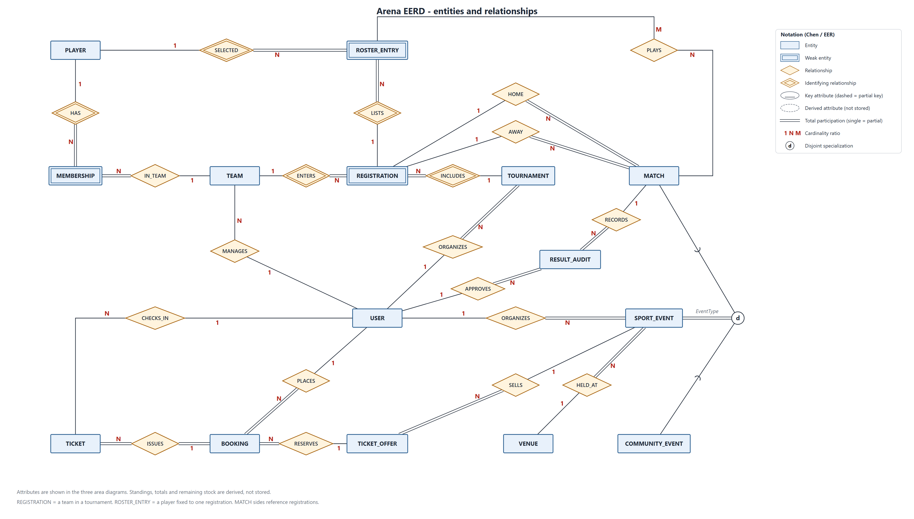
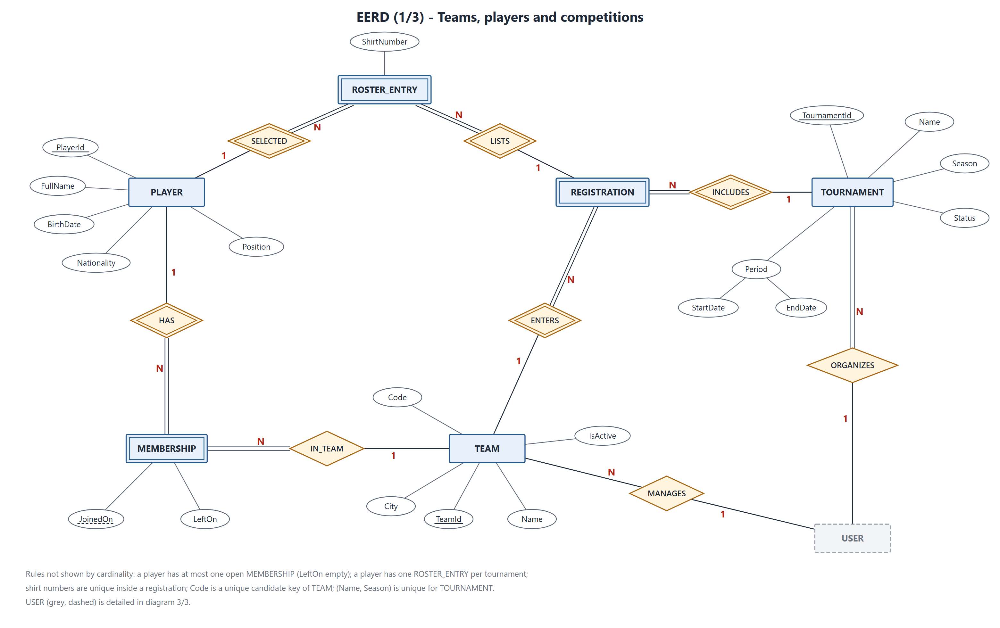
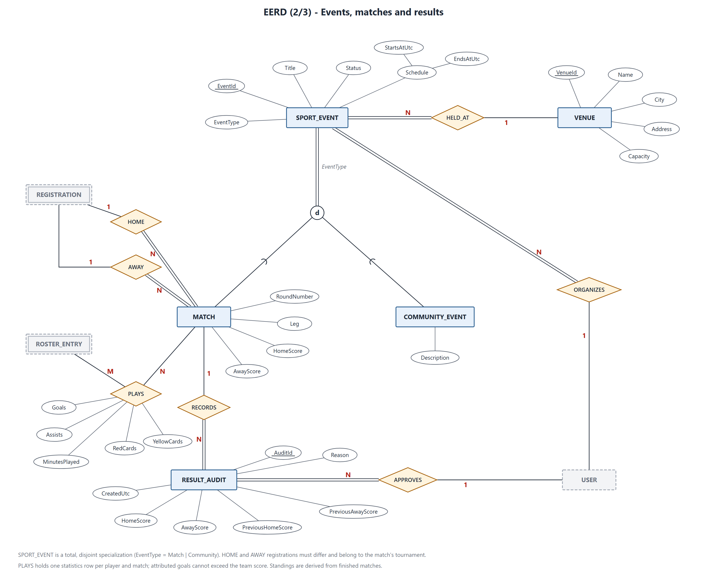
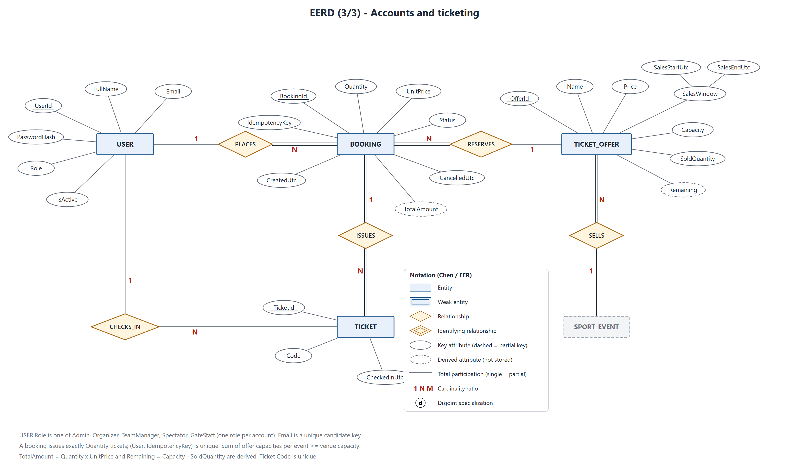
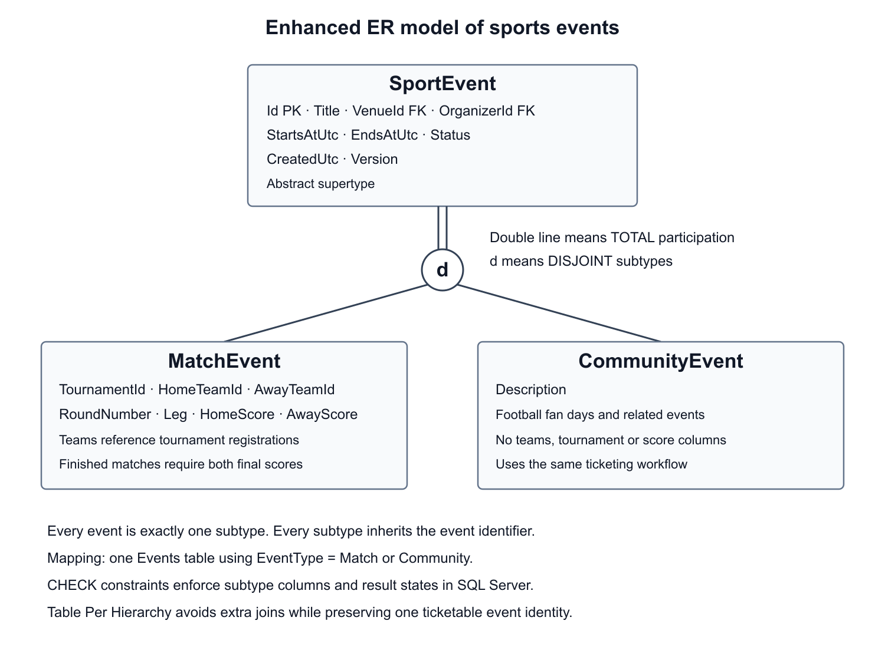
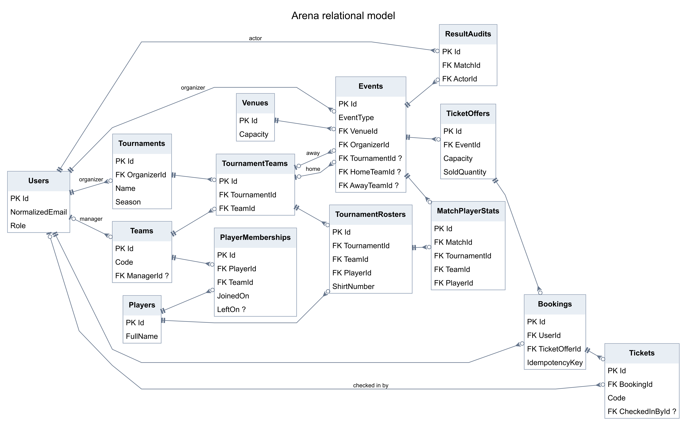

# تصميم قاعدة البيانات والتحويل العلائقي

<!-- table: kv -->
| بيانات المستند | |
|---|---|
| المشروع | Arena Football Management |
| المحتوى | النموذج المفاهيمي EERD بترميز Chen، وخطوات التحويل إلى النموذج العلائقي، وقاموس البيانات والقيود |
| قاعدة البيانات | SQL Server، عبر EF Core 10 بأسلوب Code First |
| مصدر الجداول | قاموس البيانات والمفاتيح والقيود مولدة تلقائيًا من `database/schema.json` المصدّر من نموذج EF Core |
| الإصدار | 1.1 بتاريخ 16 نوفمبر 2026 |

<!-- pagebreak -->

## سجل الإصدارات

<!-- widths: 12,20,68 -->
| الإصدار | التاريخ | التغييرات |
|---|---|---|
| 1.0 | 15 نوفمبر 2026 | مخطط التخصص ومخططات العلاقات الجدولية وقاموس البيانات وسجل المفاتيح. |
| 1.1 | 16 نوفمبر 2026 | إضافة EERD مفاهيمي كامل بترميز Chen (مخطط عام وثلاثة مخططات تفصيلية بالخصائص)، وخطوات التحويل التسع، وقائمة قيود CHECK، وتوليد الجداول من النموذج الفعلي. |

[[TOC]]

## مقدمة

يوثق هذا المستند قاعدة البيانات على مستويين:

- **النموذج المفاهيمي (EERD):** الكيانات والعلاقات والخصائص كما يراها المجال، دون مفاتيح أجنبية أو تفاصيل تخزين.
- **النموذج العلائقي:** الجداول والأعمدة والمفاتيح والقيود الناتجة عن تطبيق خطوات التحويل، وهي مطابقة لما ينفذه EF Core على SQL Server.

الجداول في قسمي قاموس البيانات والقيود مولدة من النموذج الفعلي في كل بناء للمستند، فلا تختلف عن الكود.

### ترميز المخططات

- **الكيان:** مستطيل. **الكيان الضعيف:** مستطيل مزدوج، وعلاقته المعرِّفة معين مزدوج.
- **العلاقة:** معين، وعليه نسبة الكاردينالية 1 أو N أو M بجوار كل طرف.
- **المشاركة الكلية:** خط مزدوج، أي أن كل عنصر من الكيان يجب أن يشارك في العلاقة. الخط المفرد مشاركة جزئية.
- **الخاصية المفتاحية:** بيضاوي تحته خط، والمفتاح الجزئي للكيان الضعيف تحته خط متقطع.
- **الخاصية المشتقة:** بيضاوي متقطع، تُحسب ولا تُخزن. **الخاصية المركبة:** بيضاوي تتفرع منه أجزاؤه.
- **التخصص:** دائرة فيها d تعني أن الأنواع الفرعية منفصلة، والخط المزدوج من النوع الأعلى يعني تخصصًا كليًا.

## النموذج المفاهيمي EERD

### الكيانات

<!-- widths: 20,14,22,44 -->
| الكيان | النوع | المفتاح | الوصف |
|---|---|---|---|
| USER | قوي | UserId | حساب بدور واحد: Admin أو Organizer أو TeamManager أو Spectator أو GateStaff |
| TEAM | قوي | TeamId | فريق بكود فريد ومدير اختياري |
| PLAYER | قوي | PlayerId | لاعب مستقل عن فريقه الحالي |
| MEMBERSHIP | ضعيف، مالكه PLAYER | PlayerId و JoinedOn (جزئي) | فترة عضوية اللاعب في فريق |
| TOURNAMENT | قوي | TournamentId | بطولة دوري في موسم وفترة |
| REGISTRATION | ضعيف، مالكاه TOURNAMENT و TEAM | TournamentId و TeamId | فريق مسجل في بطولة |
| ROSTER_ENTRY | ضعيف، مالكاه REGISTRATION و PLAYER | TournamentId و TeamId و PlayerId | لاعب مثبت في قائمة فريقه بالبطولة |
| VENUE | قوي | VenueId | ملعب أو مكان فعالية بسعته |
| SPORT_EVENT | قوي، نوع أعلى | EventId | فعالية في ملعب ووقت، قابلة لبيع التذاكر |
| MATCH | نوع فرعي من SPORT_EVENT | EventId (موروث) | مباراة في بطولة بين تسجيلين |
| COMMUNITY_EVENT | نوع فرعي من SPORT_EVENT | EventId (موروث) | فعالية جماهيرية بوصف |
| RESULT_AUDIT | قوي | AuditId | سجل اعتماد أو تصحيح نتيجة |
| TICKET_OFFER | قوي | OfferId | فئة تذاكر لفعالية بسعر وسعة ونافذة بيع |
| BOOKING | قوي | BookingId | حجز مستخدم لعدد من تذاكر فئة واحدة |
| TICKET | قوي | TicketId | تذكرة بكود فريد تُفحص مرة واحدة |

### العلاقات

<!-- widths: 17,30,13,40 -->
| العلاقة | الأطراف | النسبة | المشاركة والملاحظات |
|---|---|---|---|
| HAS | PLAYER و MEMBERSHIP | 1:N | معرِّفة؛ كل عضوية تخص لاعبًا (كلية من جهة العضوية) |
| IN_TEAM | MEMBERSHIP و TEAM | N:1 | كل عضوية في فريق واحد (كلية من جهة العضوية) |
| MANAGES | USER و TEAM | 1:N | جزئية من الطرفين؛ الفريق قد لا يكون له مدير |
| ENTERS | TEAM و REGISTRATION | 1:N | معرِّفة؛ كلية من جهة التسجيل |
| INCLUDES | TOURNAMENT و REGISTRATION | 1:N | معرِّفة؛ كلية من جهة التسجيل |
| ORGANIZES | USER و TOURNAMENT | 1:N | كل بطولة لها منظم (كلية من جهة البطولة) |
| LISTS | REGISTRATION و ROSTER_ENTRY | 1:N | معرِّفة؛ كلية من جهة القائمة |
| SELECTED | PLAYER و ROSTER_ENTRY | 1:N | معرِّفة؛ اللاعب له قيد واحد في كل بطولة |
| HOME | REGISTRATION و MATCH | 1:N | كل مباراة لها صاحب أرض (كلية من جهة المباراة) |
| AWAY | REGISTRATION و MATCH | 1:N | كل مباراة لها ضيف مختلف عن صاحب الأرض |
| PLAYS | MATCH و ROSTER_ENTRY | M:N | جزئية؛ خصائصها Goals و Assists و YellowCards و RedCards و MinutesPlayed |
| RECORDS | MATCH و RESULT_AUDIT | 1:N | كل سجل تدقيق يخص مباراة (كلية من جهة السجل) |
| APPROVES | USER و RESULT_AUDIT | 1:N | كل سجل له فاعل (كلية من جهة السجل) |
| HELD_AT | VENUE و SPORT_EVENT | 1:N | كل فعالية في ملعب (كلية من جهة الفعالية) |
| ORGANIZES | USER و SPORT_EVENT | 1:N | كل فعالية لها منظم (كلية من جهة الفعالية) |
| SELLS | SPORT_EVENT و TICKET_OFFER | 1:N | كل فئة تخص فعالية (كلية من جهة الفئة) |
| PLACES | USER و BOOKING | 1:N | كل حجز لمستخدم (كلية من جهة الحجز) |
| RESERVES | TICKET_OFFER و BOOKING | 1:N | كل حجز من فئة واحدة (كلية من جهة الحجز) |
| ISSUES | BOOKING و TICKET | 1:N | كلية من الطرفين؛ عدد التذاكر يساوي Quantity |
| CHECKS_IN | USER و TICKET | 1:N | جزئية؛ التذكرة لا يفحصها أحد قبل الدخول |

### المخطط العام

المخطط التالي يجمع كل الكيانات والعلاقات بنسبها ونوع المشاركة. الخصائص موجودة في المخططات التفصيلية الثلاثة بعده.

<!-- rotate -->


### الفرق واللاعبون والبطولات



العضوية كيان ضعيف لأن اللاعب قد ينتقل ويعود لنفس الفريق؛ تاريخ الانضمام يميز الفترات. التسجيل والقيد في القائمة كيانان ضعيفان: التسجيل يُعرَّف بالبطولة والفريق، والقيد يُعرَّف بالتسجيل واللاعب. هذا يجعل قائمة البطولة ثابتة حتى لو انتقل اللاعب لاحقًا.

### الفعاليات والمباريات والنتائج



المباراة لا ترتبط بالفريق مباشرة؛ ترتبط بتسجيله في البطولة عبر HOME و AWAY، فلا يمكن جدولة فريق غير مسجل. الإحصائية علاقة M:N بين المباراة والقيد في القائمة، فلا تُسجل إحصائية للاعب خارج قائمة فريقه.

### الحسابات والتذاكر



### التخصص

SPORT_EVENT نوع أعلى له نوعان فرعيان: MATCH و COMMUNITY_EVENT. التخصص **كلي** لأن كل فعالية يجب أن تكون أحدهما، و**منفصل** لأن الفعالية لا تكون مباراة وفعالية جماهيرية معًا. خاصية التمييز EventType. فائدة التخصص أن التذاكر ترتبط بالنوع الأعلى، فيعمل الحجز لأي فعالية بنفس المنطق.



### قيود لا تظهر في المخطط

- اللاعب له عضوية مفتوحة واحدة فقط (LeftOn فارغ)، ونهاية العضوية بعد بدايتها.
- اللاعب له قيد واحد في كل بطولة، ورقم القميص فريد داخل التسجيل ومن 1 إلى 99.
- طرفا المباراة مختلفان ومسجلان في بطولة المباراة نفسها.
- النتيجة مطلوبة عند انتهاء المباراة وممنوعة قبلها، وأهداف اللاعبين المنسوبة لا تتجاوز نتيجة الفريق.
- مجموع سعات فئات التذاكر لفعالية لا يتجاوز سعة الملعب، والمباع بين صفر وسعة الفئة.
- مفتاح Idempotency فريد لكل مستخدم، وكود التذكرة فريد.
- لا تتداخل فعاليتان في نفس الملعب، ولا مباراتان لنفس الفريق.

## التحويل إلى النموذج العلائقي

### خطوات التحويل

طُبقت خطوات التحويل القياسية من ER و EER إلى الجداول. كل جدول أُضيف له مفتاح بديل `Id` من نوع int يولّده SQL Server تلقائيًا، وعمود `CreatedUtc`، وعمود `Version` للتزامن. المفاتيح الطبيعية والمركبة الناتجة عن التحويل محفوظة كقيود UNIQUE أو مفاتيح بديلة، فلا يضيع معناها.

<!-- widths: 8,26,66 -->
| الخطوة | القاعدة | ما طُبق في هذا النموذج |
|---|---|---|
| 1 | الكيانات القوية | جدول لكل كيان قوي: Users و Teams و Players و Tournaments و Venues و Events و ResultAudits و TicketOffers و Bookings و Tickets. الخصائص المركبة تُفرد لأعمدة، والمشتقة لا تُخزن. |
| 2 | الكيانات الضعيفة | PlayerMemberships و TournamentTeams و TournamentRosters، ومفتاح كل منها يشمل مفتاح المالك. |
| 3 | علاقات 1:1 | لا توجد. |
| 4 | علاقات 1:N | مفتاح أجنبي في جدول الطرف N لكل علاقة (الجدول التالي). |
| 5 | علاقات M:N | PLAYS تصبح جدول MatchPlayerStats ومعها خصائصها. |
| 6 | الخصائص متعددة القيم | لا توجد. |
| 7 | العلاقات متعددة الأطراف | لا توجد؛ القائمة الثلاثية (بطولة وفريق ولاعب) مُثلت بكيانين ضعيفين. |
| 8 | التخصص | الخيار 8C: جدول واحد Events بعمود تمييز EventType (Table Per Hierarchy). |
| 9 | أنواع الاتحاد (Union) | لا توجد. |

### الخطوة 1: الكيانات القوية

<!-- widths: 22,22,56 -->
| الكيان | الجدول | ملاحظات التحويل |
|---|---|---|
| USER | Users | Email مفتاح مرشح؛ يُخزن أيضًا NormalizedEmail بحروف كبيرة لضمان التفرد دون حساسية لحالة الأحرف. |
| TEAM | Teams | Code مفتاح مرشح بقيد UNIQUE. |
| PLAYER | Players | لا يوجد عمود للفريق الحالي؛ يُعرف من العضوية المفتوحة. |
| TOURNAMENT | Tournaments | الخاصية المركبة Period تصبح StartDate و EndDate. (Name, Season) فريدان. |
| VENUE | Venues | Capacity أكبر من صفر. |
| SPORT_EVENT | Events | الخاصية المركبة Schedule تصبح StartsAtUtc و EndsAtUtc. انظر الخطوة 8. |
| RESULT_AUDIT | ResultAudits | سجل للإضافة فقط؛ لا يعدله API. |
| TICKET_OFFER | TicketOffers | SalesWindow تصبح SalesStartUtc و SalesEndUtc. Remaining مشتقة ولا تُخزن. |
| BOOKING | Bookings | TotalAmount مشتقة (Quantity × UnitPrice) ولا تُخزن. UnitPrice لقطة لسعر الفئة وقت الحجز. |
| TICKET | Tickets | Code مفتاح مرشح بقيد UNIQUE. |

### الخطوة 2: الكيانات الضعيفة

<!-- widths: 20,22,58 -->
| الكيان الضعيف | الجدول | المفتاح الناتج عن التحويل وكيف حُفظ |
|---|---|---|
| MEMBERSHIP | PlayerMemberships | (PlayerId, JoinedOn). يُحفظ بقاعدة الانتقال في الخدمة: تاريخ الانضمام الجديد يلي بداية العضوية الحالية. ويضاف فهرس فريد مشروط على PlayerId حيث LeftOn فارغ ليضمن عضوية مفتوحة واحدة. |
| REGISTRATION | TournamentTeams | (TournamentId, TeamId) مفتاح بديل، وهو الهدف الذي تشير إليه المباريات والقوائم بمفاتيح أجنبية مركبة. |
| ROSTER_ENTRY | TournamentRosters | (TournamentId, TeamId, PlayerId) مفتاح بديل، مع UNIQUE على (TournamentId, PlayerId) لقيد واحد لكل لاعب في البطولة، و UNIQUE على (TournamentId, TeamId, ShirtNumber). |

### الخطوة 4: علاقات 1:N

<!-- widths: 18,24,58 -->
| العلاقة | الجدول التابع | المفتاح الأجنبي |
|---|---|---|
| MANAGES | Teams | ManagerId إلى Users، ويقبل NULL لأن المشاركة جزئية |
| ORGANIZES | Tournaments | OrganizerId إلى Users |
| HAS، IN_TEAM | PlayerMemberships | PlayerId إلى Players، و TeamId إلى Teams |
| ENTERS، INCLUDES | TournamentTeams | TeamId إلى Teams، و TournamentId إلى Tournaments |
| LISTS، SELECTED | TournamentRosters | (TournamentId, TeamId) إلى TournamentTeams، و PlayerId إلى Players |
| HOME، AWAY | Events | (TournamentId, HomeTeamId) و (TournamentId, AwayTeamId) إلى TournamentTeams |
| HELD_AT، ORGANIZES | Events | VenueId إلى Venues، و OrganizerId إلى Users |
| RECORDS، APPROVES | ResultAudits | MatchId إلى Events، و ActorId إلى Users |
| SELLS | TicketOffers | EventId إلى Events |
| PLACES، RESERVES | Bookings | UserId إلى Users، و TicketOfferId إلى TicketOffers |
| ISSUES، CHECKS_IN | Tickets | BookingId إلى Bookings، و CheckedInById إلى Users ويقبل NULL |

> المفتاح المركب في HOME و AWAY يستخدم نفس عمود TournamentId للطرفين، فتضمن قاعدة البيانات نفسها أن الفريقين مسجلان في بطولة المباراة.

### الخطوة 5: علاقة M:N

علاقة PLAYS بين MATCH و ROSTER_ENTRY تصبح جدول **MatchPlayerStats**. يحتوي MatchId إلى Events، و (TournamentId, TeamId, PlayerId) كمفتاح أجنبي مركب إلى TournamentRosters، وخصائص العلاقة Goals و Assists و YellowCards و RedCards و MinutesPlayed. مفتاح العلاقة (MatchId, PlayerId) محفوظ كقيد UNIQUE.

### الخطوة 8: التخصص

الخيارات المتاحة: 8A جدول للنوع الأعلى وجدول لكل نوع فرعي، أو 8B جدول لكل نوع فرعي فقط، أو 8C جدول واحد بعمود نوع، أو 8D جدول واحد بأعلام لكل نوع. اخترنا **8C** لأن التخصص منفصل والأنواع الفرعية قليلة الأعمدة، ولأن فئات التذاكر تحتاج مفتاحًا أجنبيًا واحدًا لأي فعالية.

- عمود EventType يأخذ Match أو Community.
- أعمدة المباراة (TournamentId و HomeTeamId و AwayTeamId و RoundNumber و Leg و HomeScore و AwayScore) تقبل NULL في الجدول.
- قيد CK_Event_Specialization يفرض وجود أعمدة المباراة وحدها أو الوصف وحده حسب EventType، فيصبح التخصص كليًا ومنفصلًا على مستوى قاعدة البيانات.
- قيد CK_Match_Scores يفرض النتيجة عند Finished فقط.

### المخطط العلائقي الناتج

```
Users(Id, FullName, Email, NormalizedEmail, PasswordHash, Role, IsActive, CreatedUtc, Version)
Teams(Id, Name, Code, City, ManagerId -> Users, IsActive, CreatedUtc, Version)
Players(Id, FullName, BirthDate, Nationality, Position, CreatedUtc, Version)
PlayerMemberships(Id, PlayerId -> Players, TeamId -> Teams, JoinedOn, LeftOn, CreatedUtc, Version)
Tournaments(Id, Name, Season, StartDate, EndDate, OrganizerId -> Users, Status, CreatedUtc, Version)
TournamentTeams(Id, TournamentId -> Tournaments, TeamId -> Teams, CreatedUtc, Version)
TournamentRosters(Id, (TournamentId, TeamId) -> TournamentTeams, PlayerId -> Players, ShirtNumber, ...)
Venues(Id, Name, City, Address, Capacity, CreatedUtc, Version)
Events(Id, EventType, Title, VenueId -> Venues, OrganizerId -> Users, StartsAtUtc, EndsAtUtc, Status,
       TournamentId, (TournamentId, HomeTeamId) -> TournamentTeams, (TournamentId, AwayTeamId) -> TournamentTeams,
       RoundNumber, Leg, HomeScore, AwayScore, Description, CreatedUtc, Version)
MatchPlayerStats(Id, MatchId -> Events, (TournamentId, TeamId, PlayerId) -> TournamentRosters,
       Goals, Assists, YellowCards, RedCards, MinutesPlayed, CreatedUtc, Version)
ResultAudits(Id, MatchId -> Events, ActorId -> Users, PreviousHomeScore, PreviousAwayScore,
       HomeScore, AwayScore, Reason, CreatedUtc, Version)
TicketOffers(Id, EventId -> Events, Name, Price, Capacity, SoldQuantity, SalesStartUtc, SalesEndUtc, ...)
Bookings(Id, UserId -> Users, TicketOfferId -> TicketOffers, IdempotencyKey, Quantity, UnitPrice,
       Status, CancelledUtc, CreatedUtc, Version)
Tickets(Id, BookingId -> Bookings, Code, CheckedInUtc, CheckedInById -> Users, CreatedUtc, Version)
```

<!-- rotate -->


## قاموس البيانات

لكل جدول: الأعمدة كما في SQL Server، وقبول NULL، والمفاتيح. القيم الفريدة مذكورة تحت كل جدول.

<!-- BEGIN generated:data-dictionary -->
### Users

حساب واحد بدور واحد؛ البريد بعد التوحيد مفتاح مرشح. PasswordHash لا يعود في أي استجابة.

<!-- widths: 26,22,10,42 -->
| العمود | النوع في SQL Server | NULL | المفتاح والملاحظات |
|---|---|---|---|
| Id | int | لا | PK |
| CreatedUtc | datetime2 | لا | — |
| Email | nvarchar(256) | لا | — |
| FullName | nvarchar(120) | لا | — |
| IsActive | bit | لا | — |
| NormalizedEmail | nvarchar(256) | لا | — |
| PasswordHash | nvarchar(512) | لا | — |
| Role | nvarchar(30) | لا | — |
| Version | uniqueidentifier | لا | Concurrency token |

**القيم الفريدة:** `(NormalizedEmail)`

### Teams

كود ثابت وفريد ومدير اختياري. IsActive للأرشفة دون حذف التاريخ.

<!-- widths: 26,22,10,42 -->
| العمود | النوع في SQL Server | NULL | المفتاح والملاحظات |
|---|---|---|---|
| Id | int | لا | PK |
| City | nvarchar(80) | لا | — |
| Code | nvarchar(10) | لا | — |
| CreatedUtc | datetime2 | لا | — |
| IsActive | bit | لا | — |
| ManagerId | int | نعم | FK → Users(Id) |
| Name | nvarchar(120) | لا | — |
| Version | uniqueidentifier | لا | Concurrency token |

**القيم الفريدة:** `(Code)`

### Players

هوية اللاعب مستقلة عن فريقه الحالي؛ الفريق يُعرف من العضويات.

<!-- widths: 26,22,10,42 -->
| العمود | النوع في SQL Server | NULL | المفتاح والملاحظات |
|---|---|---|---|
| Id | int | لا | PK |
| BirthDate | date | لا | — |
| CreatedUtc | datetime2 | لا | — |
| FullName | nvarchar(120) | لا | — |
| Nationality | nvarchar(80) | لا | — |
| Position | nvarchar(20) | لا | — |
| Version | uniqueidentifier | لا | Concurrency token |

### PlayerMemberships

الكيان الضعيف MEMBERSHIP: فترات عضوية اللاعب، فترة واحدة فقط مفتوحة. النهاية غير شاملة.

<!-- widths: 26,22,10,42 -->
| العمود | النوع في SQL Server | NULL | المفتاح والملاحظات |
|---|---|---|---|
| Id | int | لا | PK |
| CreatedUtc | datetime2 | لا | — |
| JoinedOn | date | لا | — |
| LeftOn | date | نعم | — |
| PlayerId | int | لا | FK → Players(Id) |
| TeamId | int | لا | FK → Teams(Id) |
| Version | uniqueidentifier | لا | Concurrency token |

**القيم الفريدة:** `(PlayerId)` حيث `[LeftOn] IS NULL`

### Tournaments

بطولة دوري لموسم وفترة، ينظمها مستخدم.

<!-- widths: 26,22,10,42 -->
| العمود | النوع في SQL Server | NULL | المفتاح والملاحظات |
|---|---|---|---|
| Id | int | لا | PK |
| CreatedUtc | datetime2 | لا | — |
| EndDate | date | لا | — |
| Name | nvarchar(160) | لا | — |
| OrganizerId | int | لا | FK → Users(Id) |
| Season | nvarchar(30) | لا | — |
| StartDate | date | لا | — |
| Status | nvarchar(30) | لا | — |
| Version | uniqueidentifier | لا | Concurrency token |

**القيم الفريدة:** `(Name, Season)`

### TournamentTeams

الكيان الضعيف REGISTRATION: فريق مسجل في بطولة؛ المفتاح البديل (TournamentId, TeamId) هو مرجع المباريات والقوائم.

<!-- widths: 26,22,10,42 -->
| العمود | النوع في SQL Server | NULL | المفتاح والملاحظات |
|---|---|---|---|
| Id | int | لا | PK |
| CreatedUtc | datetime2 | لا | — |
| TeamId | int | لا | FK → Teams(Id) |
| TournamentId | int | لا | FK → Tournaments(Id) |
| Version | uniqueidentifier | لا | Concurrency token |

**القيم الفريدة:** `(TournamentId, TeamId)` (مفتاح بديل)

### TournamentRosters

الكيان الضعيف ROSTER_ENTRY: لاعب مثبت في تسجيل فريق داخل بطولة.

<!-- widths: 26,22,10,42 -->
| العمود | النوع في SQL Server | NULL | المفتاح والملاحظات |
|---|---|---|---|
| Id | int | لا | PK |
| CreatedUtc | datetime2 | لا | — |
| PlayerId | int | لا | FK → Players(Id) |
| ShirtNumber | int | لا | — |
| TeamId | int | لا | FK → TournamentTeams(TeamId) |
| TournamentId | int | لا | FK → TournamentTeams(TournamentId) |
| Version | uniqueidentifier | لا | Concurrency token |

**القيم الفريدة:** `(TournamentId, TeamId, PlayerId)` (مفتاح بديل)، `(TournamentId, PlayerId)`، `(TournamentId, TeamId, ShirtNumber)`

### Venues

ملاعب وأماكن الفعاليات وسعتها للدخول العام.

<!-- widths: 26,22,10,42 -->
| العمود | النوع في SQL Server | NULL | المفتاح والملاحظات |
|---|---|---|---|
| Id | int | لا | PK |
| Address | nvarchar(300) | لا | — |
| Capacity | int | لا | — |
| City | nvarchar(80) | لا | — |
| CreatedUtc | datetime2 | لا | — |
| Name | nvarchar(160) | لا | — |
| Version | uniqueidentifier | لا | Concurrency token |

### Events

التخصص SPORT_EVENT بنوعيه في جدول واحد (TPH)؛ الأعمدة الخاصة بكل نوع يفرضها CHECK حسب EventType.

<!-- widths: 26,22,10,42 -->
| العمود | النوع في SQL Server | NULL | المفتاح والملاحظات |
|---|---|---|---|
| Id | int | لا | PK |
| AwayScore | int | نعم | — |
| AwayTeamId | int | نعم | FK → TournamentTeams(TeamId) |
| CreatedUtc | datetime2 | لا | — |
| Description | nvarchar(2000) | نعم | — |
| EndsAtUtc | datetime2 | لا | — |
| EventType | nvarchar(20) | لا | Discriminator: Match | Community |
| HomeScore | int | نعم | — |
| HomeTeamId | int | نعم | FK → TournamentTeams(TeamId) |
| Leg | int | نعم | — |
| OrganizerId | int | لا | FK → Users(Id) |
| RoundNumber | int | نعم | — |
| StartsAtUtc | datetime2 | لا | — |
| Status | nvarchar(20) | لا | — |
| Title | nvarchar(180) | لا | — |
| TournamentId | int | نعم | FK → TournamentTeams(TournamentId) |
| VenueId | int | لا | FK → Venues(Id) |
| Version | uniqueidentifier | لا | Concurrency token |

**القيم الفريدة:** `(TournamentId, HomeTeamId, AwayTeamId, Leg)` حيث `[EventType] = 'Match'`

### MatchPlayerStats

العلاقة M:N المسماة PLAYS بين المباراة وقائمة البطولة، مع إحصائيات اللاعب.

<!-- widths: 26,22,10,42 -->
| العمود | النوع في SQL Server | NULL | المفتاح والملاحظات |
|---|---|---|---|
| Id | int | لا | PK |
| Assists | int | لا | — |
| CreatedUtc | datetime2 | لا | — |
| Goals | int | لا | — |
| MatchId | int | لا | FK → Events(Id) |
| MinutesPlayed | int | لا | — |
| PlayerId | int | لا | FK → TournamentRosters(PlayerId) |
| RedCards | int | لا | — |
| TeamId | int | لا | FK → TournamentRosters(TeamId) |
| TournamentId | int | لا | FK → TournamentRosters(TournamentId) |
| Version | uniqueidentifier | لا | Concurrency token |
| YellowCards | int | لا | — |

**القيم الفريدة:** `(MatchId, PlayerId)`

### ResultAudits

سجل كل اعتماد أو تصحيح لنتيجة مع القيم السابقة والفاعل.

<!-- widths: 26,22,10,42 -->
| العمود | النوع في SQL Server | NULL | المفتاح والملاحظات |
|---|---|---|---|
| Id | int | لا | PK |
| ActorId | int | لا | FK → Users(Id) |
| AwayScore | int | لا | — |
| CreatedUtc | datetime2 | لا | — |
| HomeScore | int | لا | — |
| MatchId | int | لا | FK → Events(Id) |
| PreviousAwayScore | int | نعم | — |
| PreviousHomeScore | int | نعم | — |
| Reason | nvarchar(500) | لا | — |
| Version | uniqueidentifier | لا | Concurrency token |

### TicketOffers

فئات التذاكر: السعر والسعة ونافذة البيع؛ SoldQuantity يتغير بأمر UPDATE شرطي واحد.

<!-- widths: 26,22,10,42 -->
| العمود | النوع في SQL Server | NULL | المفتاح والملاحظات |
|---|---|---|---|
| Id | int | لا | PK |
| Capacity | int | لا | — |
| CreatedUtc | datetime2 | لا | — |
| EventId | int | لا | FK → Events(Id) |
| Name | nvarchar(80) | لا | — |
| Price | decimal(12,2) | لا | — |
| SalesEndUtc | datetime2 | لا | — |
| SalesStartUtc | datetime2 | لا | — |
| SoldQuantity | int | لا | — |
| Version | uniqueidentifier | لا | Concurrency token |

**القيم الفريدة:** `(EventId, Name)`

### Bookings

حجز لعرض واحد بسعر محفوظ وقت الحجز ومفتاح Idempotency. لا يمثل تحصيلًا ماليًا.

<!-- widths: 26,22,10,42 -->
| العمود | النوع في SQL Server | NULL | المفتاح والملاحظات |
|---|---|---|---|
| Id | int | لا | PK |
| CancelledUtc | datetime2 | نعم | — |
| CreatedUtc | datetime2 | لا | — |
| IdempotencyKey | nvarchar(64) | لا | — |
| Quantity | int | لا | — |
| Status | nvarchar(20) | لا | — |
| TicketOfferId | int | لا | FK → TicketOffers(Id) |
| UnitPrice | decimal(12,2) | لا | — |
| UserId | int | لا | FK → Users(Id) |
| Version | uniqueidentifier | لا | Concurrency token |

**القيم الفريدة:** `(UserId, IdempotencyKey)`

### Tickets

تذكرة فردية بكود عشوائي فريد، تُفحص مرة واحدة.

<!-- widths: 26,22,10,42 -->
| العمود | النوع في SQL Server | NULL | المفتاح والملاحظات |
|---|---|---|---|
| Id | int | لا | PK |
| BookingId | int | لا | FK → Bookings(Id) |
| CheckedInById | int | نعم | FK → Users(Id) |
| CheckedInUtc | datetime2 | نعم | — |
| Code | nvarchar(64) | لا | — |
| CreatedUtc | datetime2 | لا | — |
| Version | uniqueidentifier | لا | Concurrency token |

**القيم الفريدة:** `(Code)`

<!-- END generated:data-dictionary -->

## سجل المفاتيح الأجنبية

<!-- BEGIN generated:foreign-keys -->
<!-- widths: 20,24,20,22,14 -->
| الجدول التابع | الأعمدة | الجدول الأصل | الأعمدة المرجعية | عند الحذف |
|---|---|---|---|---|
| Teams | ManagerId | Users | Id | Restrict |
| PlayerMemberships | PlayerId | Players | Id | Restrict |
| PlayerMemberships | TeamId | Teams | Id | Restrict |
| Tournaments | OrganizerId | Users | Id | Restrict |
| TournamentTeams | TeamId | Teams | Id | Restrict |
| TournamentTeams | TournamentId | Tournaments | Id | Restrict |
| TournamentRosters | PlayerId | Players | Id | Restrict |
| TournamentRosters | TournamentId, TeamId | TournamentTeams | TournamentId, TeamId | Restrict |
| Events | TournamentId, AwayTeamId | TournamentTeams | TournamentId, TeamId | Restrict |
| Events | TournamentId, HomeTeamId | TournamentTeams | TournamentId, TeamId | Restrict |
| Events | OrganizerId | Users | Id | Restrict |
| Events | VenueId | Venues | Id | Restrict |
| MatchPlayerStats | MatchId | Events | Id | Restrict |
| MatchPlayerStats | TournamentId, TeamId, PlayerId | TournamentRosters | TournamentId, TeamId, PlayerId | Restrict |
| ResultAudits | MatchId | Events | Id | Restrict |
| ResultAudits | ActorId | Users | Id | Restrict |
| TicketOffers | EventId | Events | Id | Restrict |
| Bookings | TicketOfferId | TicketOffers | Id | Restrict |
| Bookings | UserId | Users | Id | Restrict |
| Tickets | BookingId | Bookings | Id | Restrict |
| Tickets | CheckedInById | Users | Id | Restrict |

**الإجمالي:** 21 مفتاحًا أجنبيًا، وكلها تمنع الحذف التتابعي للحفاظ على التاريخ.
<!-- END generated:foreign-keys -->

## قيود CHECK

<!-- BEGIN generated:checks -->
<!-- widths: 18,26,56 -->
| الجدول | القيد | الشرط |
|---|---|---|
| Users | CK_Users_Role | `[Role] IN ('Admin','Organizer','TeamManager','Spectator','GateStaff')` |
| PlayerMemberships | CK_Membership_Dates | `[LeftOn] IS NULL OR [LeftOn] > [JoinedOn]` |
| Tournaments | CK_Tournament_Dates | `[EndDate] >= [StartDate]` |
| Tournaments | CK_Tournament_Status | `[Status] IN ('Draft','RegistrationOpen','InProgress','Completed')` |
| TournamentRosters | CK_Roster_Shirt | `[ShirtNumber] BETWEEN 1 AND 99` |
| Venues | CK_Venue_Capacity | `[Capacity] > 0` |
| Events | CK_Event_Dates | `[EndsAtUtc] > [StartsAtUtc]` |
| Events | CK_Event_Specialization | `([EventType] = 'Match' AND [TournamentId] IS NOT NULL AND [HomeTeamId] IS NOT NULL AND [AwayTeamId] IS NOT NULL AND [RoundNumber] IS NOT NULL AND [Leg] IS NOT NULL AND [Description] IS NULL) OR ([EventType] = 'Community' AND [Description] IS NOT NULL AND [TournamentId] IS NULL AND [HomeTeamId] IS NULL AND [AwayTeamId] IS NULL AND [RoundNumber] IS NULL AND [Leg] IS NULL AND [HomeScore] IS NULL AND [AwayScore] IS NULL)` |
| Events | CK_Event_Status | `[Status] IN ('Scheduled','Finished','Cancelled')` |
| Events | CK_Match_Round | `[RoundNumber] IS NULL OR ([RoundNumber] > 0 AND [Leg] BETWEEN 1 AND 2)` |
| Events | CK_Match_Scores | `[EventType] <> 'Match' OR (([Status] = 'Finished' AND [HomeScore] IS NOT NULL AND [AwayScore] IS NOT NULL AND [HomeScore] BETWEEN 0 AND 99 AND [AwayScore] BETWEEN 0 AND 99) OR ([Status] <> 'Finished' AND [HomeScore] IS NULL AND [AwayScore] IS NULL))` |
| Events | CK_Match_Teams | `[HomeTeamId] IS NULL OR [HomeTeamId] <> [AwayTeamId]` |
| MatchPlayerStats | CK_PlayerStats_Range | `[Goals] BETWEEN 0 AND 99 AND [Assists] BETWEEN 0 AND 99 AND [YellowCards] BETWEEN 0 AND 2 AND [RedCards] BETWEEN 0 AND 1 AND [MinutesPlayed] BETWEEN 0 AND 130` |
| TicketOffers | CK_Offer_Dates | `[SalesEndUtc] > [SalesStartUtc]` |
| TicketOffers | CK_Offer_Inventory | `[Capacity] > 0 AND [SoldQuantity] >= 0 AND [SoldQuantity] <= [Capacity]` |
| TicketOffers | CK_Offer_Price | `[Price] >= 0` |
| Bookings | CK_Booking_Quantity | `[Quantity] BETWEEN 1 AND 10 AND [UnitPrice] >= 0` |
| Bookings | CK_Booking_Status | `([Status] = 'Confirmed' AND [CancelledUtc] IS NULL) OR ([Status] = 'Cancelled' AND [CancelledUtc] IS NOT NULL)` |
| Tickets | CK_Ticket_CheckIn | `([CheckedInUtc] IS NULL AND [CheckedInById] IS NULL) OR ([CheckedInUtc] IS NOT NULL AND [CheckedInById] IS NOT NULL)` |

**الإجمالي:** 19 قيد CHECK.
<!-- END generated:checks -->

قواعد تشمل أكثر من صف لا يكفي لها قيد على صف واحد، فتُنفذ داخل معاملات في الخدمة: تعارض المواعيد، ومجموع سعات الفئات مقارنة بالملعب، وتطابق بطولة الإحصائية مع بطولة المباراة، وأن الحدث المشار إليه في النتائج مباراة وليس فعالية جماهيرية. لا يحتوي هذا التسليم على Triggers.

## التطبيع والبيانات المشتقة

الجداول في الصيغة الطبيعية الثالثة: كل عمود غير مفتاحي يعتمد على المفتاح كله ولا يعتمد على عمود غير مفتاحي آخر. الأسماء محفوظة في جداولها الأساسية فقط، ولا تتكرر بيانات الفريق أو المستخدم في الحجوزات والنتائج. تكرار TournamentId و TeamId في القوائم والإحصائيات مقصود لبناء مفاتيح أجنبية مركبة تفرض الانتماء، وليس تكرارًا لبيانات وصفية.

<!-- widths: 24,36,40 -->
| القيمة | القرار | السبب |
|---|---|---|
| ترتيب الدوري ونقاطه | لا يُخزن؛ يُشتق عند القراءة | تصحيح النتيجة ينعكس فورًا دون جمع مزدوج |
| TotalAmount | Quantity × UnitPrice عند القراءة | تجنب مجموع لا يطابق مكوناته |
| مجاميع الأهداف والتمريرات | تجميع إحصائيات المباريات المنتهية | عدم تكرار مجاميع قابلة للتغير |
| UnitPrice في الحجز | لقطة تاريخية مخزنة | حماية السعر المتفق عليه من تغير الفئة |
| SoldQuantity | عداد مخزن يتغير بأمر UPDATE شرطي واحد | فحص المخزون وتعديله في نفس اللحظة دون قراءة ثم كتابة |
| EventType | عمود تمييز مخزن | فرض التخصص الكلي والمنفصل |

## التنفيذ والتحقق

### المسار المعتمد Code First

تبدأ أي تغييرات من الكيانات في `src/Arena.Domain/Entities` وملفات `Persistence/Configurations`، ثم تُولّد Migration. يطبق `scripts/setup-sqlserver.ps1` القاعدة على SQL Server ويهيئ أول Admin.

```
dotnet tool restore
dotnet ef migrations add ChangeName --project src/Arena.Infrastructure --startup-project src/Arena.Api
dotnet ef database update --project src/Arena.Infrastructure --startup-project src/Arena.Api
dotnet ef migrations script --idempotent --project src/Arena.Infrastructure --startup-project src/Arena.Api
dotnet ef migrations has-pending-model-changes --project src/Arena.Infrastructure --startup-project src/Arena.Api
```

### ما يُسلم من قاعدة البيانات

- ملفات Migration و ModelSnapshot.
- `database/01_InitialCreate.sql`: سكربت idempotent يمكن تطبيقه أكثر من مرة.
- `database/02_VerifySchema.sql`: يفحص الجداول والمفاتيح والقيود بعد التطبيق.
- `database/schema.json`: النموذج العلائقي الفعلي، ومنه تتولد جداول هذا المستند.

### التحقق المنجز

- طُبقت Migration من التطبيق، وطُبق السكربت مرتين على قاعدة فارغة، على SQL Server 2025 (LocalDB): 14 جدولًا و 21 مفتاحًا أجنبيًا كلها موثوقة و 19 قيد CHECK و 13 فهرسًا فريدًا، منها فهرسان مشروطان.
- النموذج مطابق للـ Migration، والمخطط المصدّر مطابق لـ `database/schema.json`.
- اختبار التزامن على SQL Server ناجح: لا بيع زائد ولا أخطاء 500 مع 100 طلب متزامن.
- يتبقى تطبيق القاعدة على خادم الفريق وحفظ نسخة احتياطية بعدها.

### إذا اختير DB First مستقبلًا

ينشئ الفريق القاعدة أولًا، ثم يستخدم `dotnet ef dbcontext scaffold` مع مزود SQL Server في مجلد مستقل. لا يُشغَّل Scaffold فوق الملفات الحالية باستخدام force دون مراجعة، لأنه يمحو ملفات Configuration. تغيير المسار قرار معماري للفريق، وليس خطوة ناقصة في Code First.
